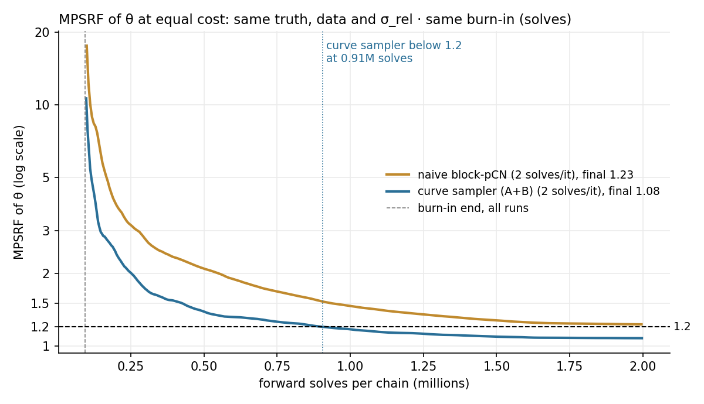
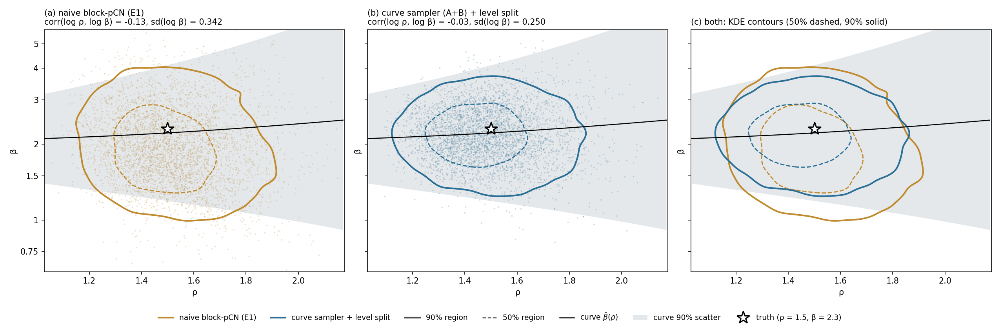

# Bayesian Inversion of a Hierarchical Log-Permeability Model

This repository investigates Bayesian inverse problems for the permeability input to Darcy flow problems. The output of the MCMC algorithm is a posterior distribution on permeability informed from the provided measurements. The current studies use synthetic data from
flow experiment (pressures, or tracer concentrations over time). This repository contains code for building models, running and managing Markov chain
Monte Carlo (MCMC) samplers, and producing various accompanying post-processing figures.

The main contribution in this package is the study of a hierarchical permeability model. These models extend the common KLE model with two parameters. These are the overall permeability level, and the strength of the heterogeneity. These models are
physically natural but partly unidentifiable from pressure data, which leads to poor sampling from classic pCN MCMC chains. We include the measurement of a sample's effective permeability, which along with a curve-based sampler we derive, solves this identifiability issue.

This code is very much in research stage, use with caution. 

**Authors.** Aidan Gettemy, with
Felipe Pereira (University of Texas at Dallas),
Marcio Borges (Laboratório Nacional de Computação
Científica, LNCC) and Rafael Guiraldello (Piri Technologies).

**Acknowledgements.**
- The 2D/3D forward solver (`brho/fv.py`) follows Marcio Borges' finite-volume slab solver.
- The convergence diagnostics port Felipe Pereira's MATLAB MPSRF routines.
- Claude Code (Anthropic) was used to synthesize the existing KLE codes, forward solver, MCMC samplers and
  auxiliary files into this package, and to keep the repository organized.

---

## The model

**Forward problem.** Simple case is single-phase Darcy flow through a sample occupying the unit square or cube. The
pressure p solves

$$-\nabla\cdot(\kappa\nabla p) = 0, \qquad -\kappa\nabla p\cdot n = q_{\text{in}} \text{ on the inflow face}, \qquad p = 0 \text{ on the outflow face},$$

with no flow through the remaining faces. It is discretized with a cell-centred finite-volume
(two-point flux) scheme. The forward solve is part of the likelihood: every proposed permeability field
costs one solve.

**Prior: a hierarchical log-Gaussian field.** The log-permeability is

$$\log\kappa = \log\beta + \rho\,G(\boldsymbol\theta), \qquad G(\boldsymbol\theta) = T\boldsymbol\theta, \qquad \boldsymbol\theta\sim N(0, I_r).$$

- G is a mean-zero Gaussian random field with a squared-exponential covariance in 2D or 3D. It is
  parameterized by its truncated **Karhunen–Loève expansion** (KLE): the columns of T are the leading r
  modes, and the coefficients θ set the **shape** of the field.
- The standard model stops at θ, which forces the field to have mean zero and unit variance. Real rocks
  have neither, so we add two hierarchical parameters:
  - **β**, the baseline permeability (the level);
  - **ρ**, the heterogeneity amplitude (how strongly the field varies).

  Both carry log-normal priors.

**Likelihood.** A relative-error Gaussian misfit between the observed pressures d and the model's pressures
at the sensors:

$$\Phi(\kappa) = \frac{\lVert d - O\,p(\kappa)\rVert^2}{2\,\sigma_{\text{rel}}^2\,\lVert d\rVert^2},$$

with O the observation operator and σ_rel the noise level. It is dimensionless and does not change with
mesh refinement. The posterior is π(θ, ρ, β | d) ∝ exp(−Φ) · π₀(θ) π₀(ρ) π₀(β).

## The challenge: lack of identifiability

With an inflow flux and a fixed outlet pressure, scaling the permeability by b scales the pressure by 1/b.
From this flux-scaling lemma follow two exact invariances (paper, Lemmas 1–2):

1. **Level swap.** The pressures fix the overall level of log κ, but not how it is split between β and the
   mean of the field ρG(θ). Raising β and lowering θ along the constant-field direction leaves the data
   unchanged.
2. **Amplitude swap.** The pressures fix the product ρθ, but not how it is split between ρ and the size of θ.

The data therefore identify r combinations of the r + 2 unknowns (β, ρ, θ). The **naive block-pCN
sampler** has to random-walk along the level-swap ridge in β. At equal cost it fails to converge: after
2 million forward solves per chain, its log β still has PSRF 1.22. And its β posterior is set by an
arbitrary prior choice rather than by the physics.

## The fix: the β(ρ) curve sampler

**One extra datum.** The measured effective permeability K* of the sample (a standard core-lab
measurement) ties β to ρ. By the same scaling lemma, a field with level β has K_eff = β · K_eff(β = 1).

**Offline curve.** An offline Monte Carlo over prior fields gives, for each amplitude ρ, the level that
reproduces K* on average:

$$\bar\beta(\rho) = \frac{K^*}{\frac{1}{M}\sum_i K_{\text{eff},i}(\rho)}.$$

This is trivially parallel and is done once, before any MCMC.

**Online sampler.** Setting β = β̄(ρ) removes β as an unknown, and with it the level ridge. The **curve
sampler** alternates two preconditioned Crank–Nicolson (pCN) moves:
- move A on the shape θ;
- move B on log ρ.

Each costs one forward solve, is gradient-free, and has a likelihood-only acceptance ratio. The amplitude
ridge needs no special move: the prior on θ, whose norm concentrates near √r, is informative enough to
settle it.

**β for free.** On the curve, β is only a function of ρ, so its interval may be too narrow. A post-processing
step, the **level split**, restores the honest uncertainty in β. It uses the curve's scatter
s(ρ) as the prior log β | ρ ~ N(log β̄(ρ), s(ρ)²). The conditional posterior of log β given each kept
sample is then Gaussian in closed form. Each sample is moved along the level-swap
direction, so log κ, ρ and every field summary are unchanged, and **no forward solves** are needed.

## Results (2D Poisson problem)

A 32 × 32 grid with r = 57 KLE modes, 512 pressure sensors, σ_rel = 2 × 10⁻³, and true (β, ρ) = (2.3, 1.5).
Each sampler ran 64 chains at **2.0 million forward solves per chain**, with the same truth, data and burn-in.

| | naive block-pCN | curve sampler | truth |
|---|---|---|---|
| ρ | 1.50 [1.25, 1.83] | 1.47 [1.23, 1.79] | 1.5 |
| level (mean of log κ) | 0.862 [0.736, 0.938] | 0.867 [0.747, 0.939] | 0.835 |
| β | 1.92 [1.15, 3.47] | 2.17 [1.44, 3.26] (after the level split) | 2.3 |
| θ convergence (MPSRF < 1.2) | not reached | 0.91M solves | |
| 90% coverage of log κ | 95.7% | 95.6% | |

Medians with 90% intervals. The two samplers recover **the same permeability field**, as they must, since
the data pin log κ. They differ in two ways:
- **Speed:** the curve sampler converges, and the naive one does not within the same budget.
- **β:** the curve sampler's β comes from the relationship with effective permeability. The naive sampler's β is only determined by the prior.

| | |
|---|---|
|  |  |
| Convergence of θ at equal cost (MPSRF against forward solves). | Joint posterior of (ρ, β): naive sampler (left), curve sampler with the level split (middle), both overlaid. |

## Experiments

Each experiment has a **runner** in `experiments/` that only computes, and a **report** in `reports/` that only
reads results and writes figures and tables. Committed results live under `runs/<study>/`, with
`figures/`, `tables/` and the run manifests; the chains themselves stay on the cluster.

### Darcy flow in 2D

- **Non-uniqueness (E2):** a 5 × 5 grid of fixed (β, ρ) pairs, sampling only θ. Every pair fits the data
  equally well.
  - Code: `experiments/run_grid_study.py`, `reports/report_grid.py`.
  - Results: `runs/e2_grid_2026-09/figures/e2_grid/`. See `fig_grid_beta_rho.png`, `fig_grid_beta_rho_relerr.png`
    and `fig_grid_fields.png`.
- **Naive sampler (E1):** joint block-pCN on (θ, β, ρ).
  - Code: `experiments/run_e1_naive.py`, `reports/report_e1.py`.
  - Results: `runs/cluster_kle/figures/e1_blocked/`. The comparison with the curve sampler is in
    `runs/cluster_kle_sig2e3/figures/e1_vs_e4_ab/`.
- **Offline curve β̄(ρ) (E3):** Monte Carlo over 1,024 prior fields at 40 values of ρ.
  - Code: `experiments/run_beta_curve.py`, `reports/report_curve.py`.
  - Results: `runs/cluster_kle/figures/e3_curve/`. The curve with the posterior on it is
    `runs/cluster_kle_sig2e3/figures/e4_sampler_ab/fig_e4_curve_band.png`.
- **Curve sampler with two pCN moves:**
  - Code: `experiments/run_curve_sampler.py --moves AB`, `reports/report_sampler.py`. The level split is
    `brho/beta_upgrade.py`, run through `reports/report_beta_upgrade.py`.
  - Results: `runs/cluster_kle_sig2e3/figures/e4_sampler_ab/`. Six ways of obtaining β are compared in
    `fig_beta_methods.png`.

### The 3D core-plug problem (tracer data)

- **3D offline curve:** the β̄(ρ) curve for a 38 × 38 × 45 cylindrical core plug, computed with the an
  external Darcy solver (not part of this repository) and multiscale whitened fields. It is fitted with
  even polynomials and a monotone spline interpolant.
  - Code: `experiments/run_external_curve.py`.
  - Setup: `external/README.md`.
- **GLAM sampler** (global-local anchored multistage sampling): the multiscale sampler on the PCHIP curve,
  with pressure-drop and tracer-concentration data, one chain per MPI rank.
  - Code: `experiments/run_glam.py`, `brho/glam/`.
  - Results: `runs/glam_*`.

### Additional capabilities

- **Multiscale sampling:** local-KLE subdomain proposals and their whitening, following
  Ali, Al-Mamun, Pereira & Rahunanthan,
  ["Multiscale sampling for the inverse modeling of partial differential equations"](https://www.sciencedirect.com/science/article/abs/pii/S0021999123007040),
  *J. Comput. Phys.* 497 (2024) 112609.
  - Code: `brho/multiscale.py`, `brho/blockpcn.py`.
- **External solver port:** a solver contract any Darcy code can satisfy (`brho/darcy_external.py`).
- **Sampler variants:**
  - a soft-curve sampler with ridge and level-swap moves (E5);
  - block (subdomain) pCN;
  - learned noise level;
  - frozen-parameter baselines;
  - an importance-sampling feasibility test.

  Each is documented in the technical guide.

## Getting started

```bash
pip install -r requirements.txt
make test      # unit checks: scaling lemma, KLE, solver, curve, prior invariance
make quick     # the whole 2D pipeline with tiny budgets, into runs/quick/
make all       # the production 2D pipeline on one machine
```

On a cluster, each experiment splits into a setup step, parallel chains and a collect step, submitted as
SLURM jobs. See `cluster/README.md` and `cluster/CHEATSHEET.md`.

## Repository map

```
brho/          the library: forward solver, KLE, priors, likelihood, samplers, diagnostics
experiments/   runners (compute only; write results/ and a manifest)
reports/       figures and tables from finished runs (read only)
cluster/       SLURM job scripts, environment, cheatsheet
external/      pointers and contract for the external 3D solver (the solver itself is not included)
runs/          committed results of each study (figures, tables, manifests; no chains)
tests/         unit checks (make test)
docs/          the technical guide
LOG.md         dated log of every run: settings, headline numbers, decisions
```

## Further reading

- **[docs/technical_guide.md](docs/technical_guide.md):** every experiment, figure, modelling switch and
  run folder in detail.
- **`LOG.md`:** repository activity.
- **Background on the hierarchical model and the non-uniqueness:** project reports.
