# betarho 2D - results summary

## e3_curve

**curve_table**

| rho | f_mean | f_se | beta_ratio_of_mean | beta_mean_of_ratio | beta_median | beta_std | beta_q05 | beta_q95 | keff_relstd |
|---|---|---|---|---|---|---|---|---|---|
| 0.05 | 1 | 0.0003515 | 2.036 | 2.036 | 2.036 | 0.02292 | 1.998 | 2.074 | 0.01125 |
| 0.1769 | 1 | 0.001247 | 2.036 | 2.04 | 2.039 | 0.08157 | 1.907 | 2.174 | 0.03989 |
| 0.3038 | 0.9987 | 0.002147 | 2.039 | 2.049 | 2.045 | 0.1415 | 1.824 | 2.281 | 0.06879 |
| 0.4308 | 0.9963 | 0.003054 | 2.044 | 2.064 | 2.055 | 0.2036 | 1.747 | 2.395 | 0.09808 |
| 0.5577 | 0.9926 | 0.003967 | 2.052 | 2.085 | 2.074 | 0.2688 | 1.677 | 2.526 | 0.1279 |
| 0.6846 | 0.9876 | 0.004888 | 2.062 | 2.114 | 2.092 | 0.3379 | 1.614 | 2.671 | 0.1584 |
| 0.8115 | 0.9812 | 0.005815 | 2.075 | 2.151 | 2.115 | 0.4123 | 1.551 | 2.837 | 0.1896 |
| 0.9385 | 0.9733 | 0.006746 | 2.092 | 2.197 | 2.148 | 0.4934 | 1.504 | 3.015 | 0.2218 |
| 1.065 | 0.9637 | 0.007681 | 2.113 | 2.253 | 2.19 | 0.5832 | 1.449 | 3.217 | 0.2551 |
| 1.192 | 0.9525 | 0.008621 | 2.138 | 2.321 | 2.236 | 0.6841 | 1.405 | 3.469 | 0.2896 |
| 1.319 | 0.9396 | 0.009565 | 2.167 | 2.403 | 2.285 | 0.7997 | 1.368 | 3.772 | 0.3258 |
| 1.446 | 0.925 | 0.01051 | 2.202 | 2.502 | 2.347 | 0.9348 | 1.339 | 4.118 | 0.3638 |
| 1.573 | 0.9088 | 0.01147 | 2.241 | 2.62 | 2.415 | 1.096 | 1.295 | 4.66 | 0.4039 |
| 1.7 | 0.8912 | 0.01243 | 2.285 | 2.762 | 2.505 | 1.294 | 1.247 | 5.142 | 0.4465 |
| 1.827 | 0.8723 | 0.0134 | 2.335 | 2.933 | 2.595 | 1.543 | 1.205 | 5.689 | 0.4916 |
| 1.954 | 0.8526 | 0.01438 | 2.389 | 3.141 | 2.707 | 1.862 | 1.161 | 6.526 | 0.5396 |
| 2.081 | 0.8321 | 0.01535 | 2.447 | 3.393 | 2.822 | 2.282 | 1.136 | 7.519 | 0.5903 |
| 2.208 | 0.8112 | 0.01632 | 2.511 | 3.703 | 2.967 | 2.845 | 1.118 | 8.635 | 0.6439 |
| 2.335 | 0.7901 | 0.0173 | 2.578 | 4.085 | 3.123 | 3.614 | 1.102 | 9.996 | 0.7005 |
| 2.462 | 0.7689 | 0.01827 | 2.648 | 4.562 | 3.277 | 4.678 | 1.084 | 11.81 | 0.7602 |
| 2.588 | 0.748 | 0.01924 | 2.722 | 5.162 | 3.47 | 6.17 | 1.066 | 14.43 | 0.823 |
| 2.715 | 0.7275 | 0.02021 | 2.799 | 5.923 | 3.736 | 8.288 | 1.059 | 17.91 | 0.8891 |
| 2.842 | 0.7074 | 0.02119 | 2.879 | 6.898 | 3.984 | 11.33 | 1.06 | 22.07 | 0.9587 |
| 2.969 | 0.6879 | 0.02218 | 2.961 | 8.161 | 4.269 | 15.72 | 1.024 | 27.8 | 1.032 |
| 3.096 | 0.669 | 0.02319 | 3.044 | 9.811 | 4.591 | 22.14 | 0.9949 | 35.25 | 1.109 |
| 3.223 | 0.6508 | 0.02421 | 3.129 | 11.99 | 5.004 | 31.6 | 0.9785 | 45.69 | 1.19 |
| 3.35 | 0.6333 | 0.02526 | 3.216 | 14.89 | 5.394 | 45.64 | 0.9924 | 57 | 1.276 |
| 3.477 | 0.6166 | 0.02633 | 3.303 | 18.79 | 5.785 | 66.62 | 0.9725 | 71.25 | 1.367 |
| 3.604 | 0.6007 | 0.02744 | 3.39 | 24.07 | 6.312 | 98.17 | 0.9627 | 90.56 | 1.462 |
| 3.731 | 0.5855 | 0.02858 | 3.478 | 31.31 | 6.875 | 145.9 | 0.9606 | 116.7 | 1.562 |
| 3.858 | 0.5711 | 0.02977 | 3.566 | 41.28 | 7.502 | 218.3 | 0.9722 | 151.2 | 1.668 |
| 3.985 | 0.5574 | 0.03099 | 3.653 | 55.13 | 7.958 | 328.7 | 0.9776 | 197.3 | 1.779 |
| 4.112 | 0.5445 | 0.03226 | 3.74 | 74.52 | 8.786 | 497.5 | 0.9998 | 259 | 1.896 |
| 4.238 | 0.5324 | 0.03357 | 3.825 | 101.8 | 9.767 | 756.6 | 0.9935 | 334.3 | 2.018 |
| 4.365 | 0.5209 | 0.03494 | 3.909 | 140.6 | 10.75 | 1155 | 1.001 | 438.2 | 2.146 |
| 4.492 | 0.5102 | 0.03636 | 3.992 | 195.9 | 11.72 | 1769 | 1.001 | 585.1 | 2.281 |
| 4.619 | 0.5001 | 0.03784 | 4.072 | 275.4 | 13.01 | 2718 | 0.9941 | 752.4 | 2.421 |
| 4.746 | 0.4907 | 0.0394 | 4.15 | 390.1 | 14.38 | 4185 | 1.024 | 965.1 | 2.569 |
| 4.873 | 0.482 | 0.04102 | 4.225 | 556.6 | 16.2 | 6458 | 1.024 | 1258 | 2.723 |
| 5 | 0.4739 | 0.04272 | 4.297 | 799.6 | 18.27 | 9982 | 1.068 | 1649 | 2.885 |


`tables/e3_curve/curve_summary.json`

```json
{
 "Kstar": 2.0364838809194694,
 "statistic": "ratio_of_mean",
 "n_real": 1024,
 "n_rho": 40,
 "rho_range": [
  0.05,
  5.0
 ],
 "beta_bar_at_rho_true": 2.2177398688872305,
 "beta_true": 2.3,
 "rel_err_at_truth": -0.03576527439685617,
 "beta_bar_at_0": 2.0364838809194694,
 "band_at_rho_true": [
  1.3388503078418699,
  4.118216781803107
 ],
 "minutes": 1.9498576800028482,
 "cholesky_vs_kle_beta_at_truth": 0.014701113577814118
}
```

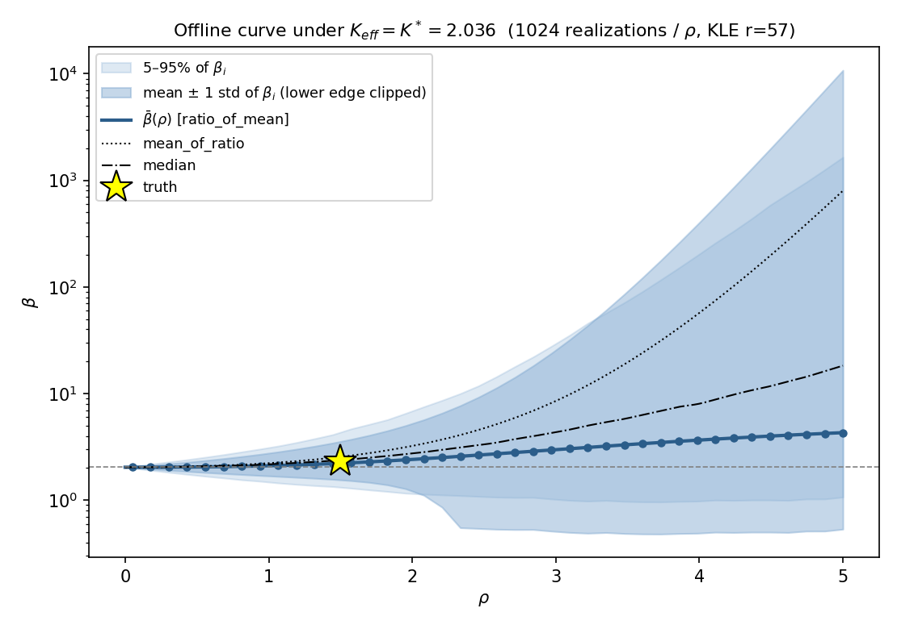

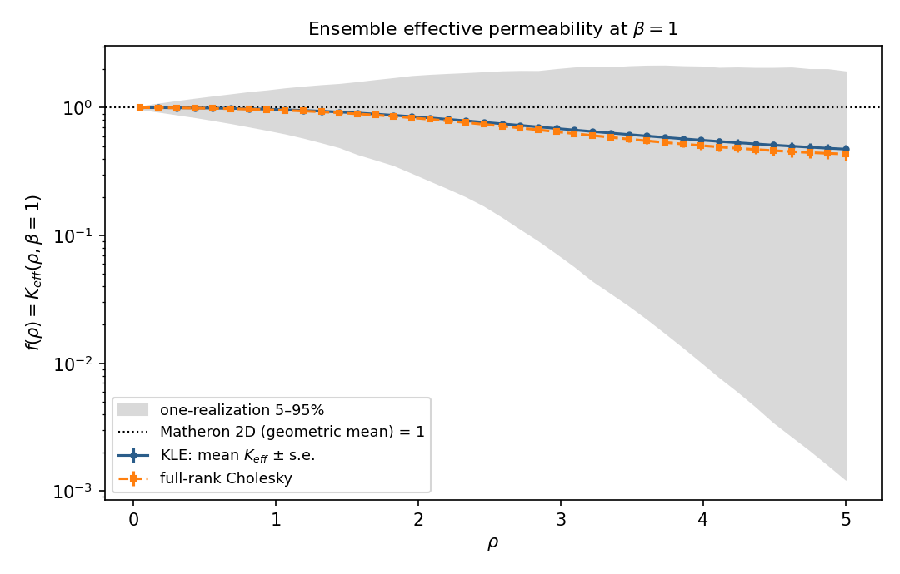

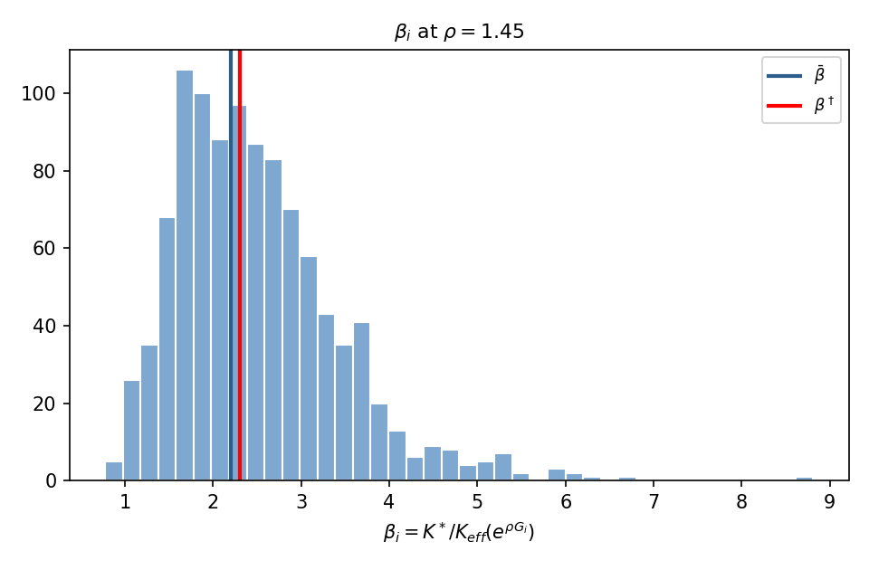

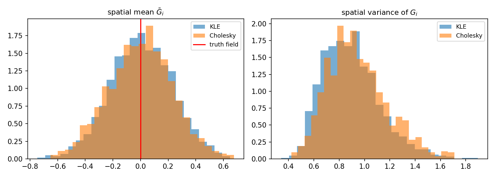

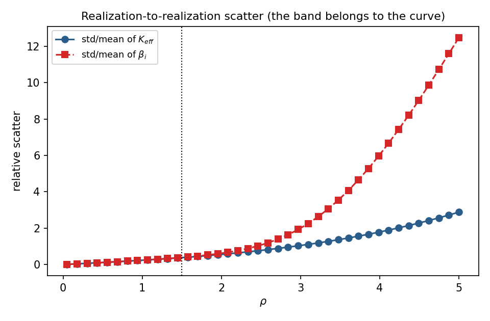

## e4_sampler

**e4_chains**

| chain | acc_A | acc_B | acc_C | s_theta | s_w | s_rg | rho_mean | level_mean | phi_mean |
|---|---|---|---|---|---|---|---|---|---|
| 0 | 0.1951 | 0.2609 | 0.3518 | 0.00628 | 0.03262 | 0.01318 | 1.612 | 0.8457 | 239.9 |
| 1 | 0.262 | 0.2959 | 0.4191 | 0.005007 | 0.02601 | 0.0105 | 1.571 | 0.8463 | 244.6 |
| 2 | 0.1864 | 0.2621 | 0.4079 | 0.00628 | 0.02601 | 0.0105 | 1.598 | 0.7575 | 241.3 |
| 3 | 0.2672 | 0.2327 | 0.5317 | 0.005007 | 0.03262 | 0.006676 | 1.558 | 0.8605 | 242.8 |
| 4 | 0.2152 | 0.286 | 0.2901 | 0.00628 | 0.02073 | 0.02073 | 1.515 | 0.8972 | 245 |
| 5 | 0.2718 | 0.2271 | 0.4291 | 0.005007 | 0.03262 | 0.0105 | 1.54 | 0.8826 | 245.4 |
| 6 | 0.2613 | 0.262 | 0.422 | 0.005007 | 0.02601 | 0.0105 | 1.549 | 0.8958 | 252.2 |
| 7 | 0.2164 | 0.2586 | 0.399 | 0.00628 | 0.02601 | 0.01318 | 1.463 | 0.8686 | 248.1 |
| 8 | 0.1794 | 0.2568 | 0.3755 | 0.00628 | 0.03262 | 0.0105 | 1.701 | 0.8719 | 239.6 |
| 9 | 0.2684 | 0.283 | 0.4356 | 0.005007 | 0.02601 | 0.0105 | 1.521 | 0.8759 | 249.4 |
| 10 | 0.2004 | 0.2557 | 0.3207 | 0.00628 | 0.03262 | 0.01653 | 1.557 | 0.8301 | 243.3 |
| 11 | 0.1906 | 0.2641 | 0.4039 | 0.00628 | 0.03262 | 0.0105 | 1.606 | 0.8225 | 239.3 |
| 12 | 0.2639 | 0.2556 | 0.4228 | 0.005007 | 0.02601 | 0.0105 | 1.559 | 0.8771 | 240.9 |
| 13 | 0.1924 | 0.2497 | 0.4073 | 0.00628 | 0.03262 | 0.0105 | 1.59 | 0.8479 | 246.1 |
| 14 | 0.2101 | 0.3607 | 0.3326 | 0.00628 | 0.01653 | 0.01653 | 1.517 | 0.8724 | 240.7 |
| 15 | 0.2209 | 0.2445 | 0.3986 | 0.00628 | 0.03262 | 0.01318 | 1.468 | 0.8835 | 241 |
| 16 | 0.2104 | 0.2344 | 0.4382 | 0.00628 | 0.03262 | 0.0105 | 1.51 | 0.8518 | 238.4 |
| 17 | 0.2697 | 0.2334 | 0.4846 | 0.005007 | 0.03262 | 0.008374 | 1.538 | 0.8794 | 240.4 |
| 18 | 0.2091 | 0.213 | 0.436 | 0.00628 | 0.04092 | 0.0105 | 1.512 | 0.879 | 248.6 |
| 19 | 0.1983 | 0.2209 | 0.3649 | 0.00628 | 0.04092 | 0.01318 | 1.576 | 0.8378 | 244.9 |
| 20 | 0.2139 | 0.2561 | 0.3898 | 0.00628 | 0.02601 | 0.01318 | 1.494 | 0.9045 | 246.9 |
| 21 | 0.2099 | 0.2468 | 0.3825 | 0.00628 | 0.03262 | 0.01318 | 1.513 | 0.8496 | 243.3 |
| 22 | 0.2823 | 0.2867 | 0.4568 | 0.005007 | 0.02601 | 0.0105 | 1.461 | 0.8462 | 247.7 |
| 23 | 0.1911 | 0.2957 | 0.2676 | 0.00628 | 0.02601 | 0.02073 | 1.612 | 0.8077 | 235.6 |
| 24 | 0.2684 | 0.2559 | 0.3804 | 0.005007 | 0.02601 | 0.01318 | 1.529 | 0.8512 | 246.7 |
| 25 | 0.2092 | 0.2614 | 0.3786 | 0.00628 | 0.02601 | 0.01318 | 1.52 | 0.8804 | 247 |
| 26 | 0.1475 | 0.2775 | 0.3228 | 0.007878 | 0.02601 | 0.01653 | 1.538 | 0.8567 | 245.9 |
| 27 | 0.2665 | 0.2878 | 0.484 | 0.005007 | 0.02601 | 0.008374 | 1.54 | 0.822 | 239.3 |
| 28 | 0.2604 | 0.2391 | 0.4754 | 0.005007 | 0.03262 | 0.008374 | 1.565 | 0.8566 | 240.6 |
| 29 | 0.2004 | 0.2624 | 0.3666 | 0.00628 | 0.02601 | 0.01318 | 1.561 | 0.8938 | 237.4 |
| 30 | 0.2554 | 0.239 | 0.41 | 0.005007 | 0.03262 | 0.0105 | 1.59 | 0.8462 | 246 |
| 31 | 0.2721 | 0.2796 | 0.4281 | 0.005007 | 0.02601 | 0.0105 | 1.526 | 0.8862 | 237.5 |
| 32 | 0.2042 | 0.2892 | 0.3258 | 0.00628 | 0.02601 | 0.01653 | 1.531 | 0.8432 | 236.7 |
| 33 | 0.3103 | 0.235 | 0.4395 | 0.003991 | 0.03262 | 0.008374 | 1.679 | 0.8556 | 244 |
| 34 | 0.2128 | 0.2559 | 0.4416 | 0.00628 | 0.02601 | 0.0105 | 1.502 | 0.8854 | 248.7 |
| 35 | 0.2055 | 0.3023 | 0.3246 | 0.00628 | 0.02073 | 0.01653 | 1.541 | 0.9124 | 246.6 |
| 36 | 0.2593 | 0.3042 | 0.4067 | 0.005007 | 0.02073 | 0.0105 | 1.602 | 0.9024 | 243.2 |
| 37 | 0.2725 | 0.232 | 0.5448 | 0.005007 | 0.03262 | 0.006676 | 1.533 | 0.8783 | 242.8 |
| 38 | 0.2501 | 0.2462 | 0.4533 | 0.005007 | 0.03262 | 0.008374 | 1.619 | 0.8419 | 240.7 |
| 39 | 0.2724 | 0.2562 | 0.4903 | 0.005007 | 0.03262 | 0.008374 | 1.514 | 0.8637 | 245.2 |
| 40 | 0.1443 | 0.2864 | 0.3172 | 0.007878 | 0.02601 | 0.01653 | 1.575 | 0.8461 | 241.7 |
| 41 | 0.3158 | 0.2122 | 0.5069 | 0.003991 | 0.04092 | 0.006676 | 1.639 | 0.846 | 239.1 |
| 42 | 0.2171 | 0.2502 | 0.4472 | 0.00628 | 0.02601 | 0.0105 | 1.487 | 0.908 | 241 |
| 43 | 0.1965 | 0.2757 | 0.3634 | 0.00628 | 0.02601 | 0.01318 | 1.574 | 0.8307 | 239.9 |
| 44 | 0.2725 | 0.2319 | 0.4896 | 0.005007 | 0.03262 | 0.008374 | 1.528 | 0.9 | 245.4 |
| 45 | 0.2618 | 0.2283 | 0.4856 | 0.005007 | 0.03262 | 0.008374 | 1.529 | 0.7941 | 248 |
| 46 | 0.2739 | 0.264 | 0.545 | 0.005007 | 0.03262 | 0.006676 | 1.529 | 0.8769 | 249.5 |
| 47 | 0.1547 | 0.2958 | 0.332 | 0.007878 | 0.02601 | 0.01653 | 1.514 | 0.8563 | 242.3 |
| 48 | 0.2029 | 0.2798 | 0.3743 | 0.00628 | 0.02601 | 0.01318 | 1.541 | 0.8761 | 256.1 |
| 49 | 0.2831 | 0.2337 | 0.3997 | 0.005007 | 0.03262 | 0.01318 | 1.469 | 0.8729 | 245 |
| 50 | 0.1846 | 0.2882 | 0.2616 | 0.00628 | 0.02601 | 0.02073 | 1.648 | 0.8175 | 240.8 |
| 51 | 0.2635 | 0.2417 | 0.5866 | 0.005007 | 0.03262 | 0.005322 | 1.565 | 0.8641 | 241.1 |
| 52 | 0.2651 | 0.2842 | 0.4239 | 0.005007 | 0.02601 | 0.0105 | 1.549 | 0.8601 | 239.1 |
| 53 | 0.2117 | 0.2635 | 0.3285 | 0.00628 | 0.02601 | 0.01653 | 1.536 | 0.9064 | 240.6 |
| 54 | 0.2076 | 0.2484 | 0.4264 | 0.00628 | 0.03262 | 0.0105 | 1.546 | 0.8733 | 238 |
| 55 | 0.206 | 0.313 | 0.3276 | 0.00628 | 0.02073 | 0.01653 | 1.545 | 0.8767 | 248.3 |
| 56 | 0.2717 | 0.2017 | 0.4848 | 0.005007 | 0.04092 | 0.008374 | 1.539 | 0.8928 | 246 |
| 57 | 0.2644 | 0.2352 | 0.4107 | 0.005007 | 0.03262 | 0.0105 | 1.585 | 0.8949 | 238.3 |
| 58 | 0.2535 | 0.3139 | 0.4031 | 0.005007 | 0.02601 | 0.0105 | 1.605 | 0.7932 | 243.6 |
| 59 | 0.3287 | 0.2416 | 0.4792 | 0.003991 | 0.03262 | 0.008374 | 1.558 | 0.8486 | 248.2 |
| 60 | 0.2035 | 0.2711 | 0.3243 | 0.00628 | 0.02601 | 0.01653 | 1.537 | 0.8728 | 239.1 |
| 61 | 0.2625 | 0.2674 | 0.3685 | 0.005007 | 0.02601 | 0.01318 | 1.561 | 0.8445 | 242.4 |
| 62 | 0.2579 | 0.2634 | 0.5201 | 0.005007 | 0.03262 | 0.006676 | 1.593 | 0.8226 | 239.4 |
| 63 | 0.3307 | 0.2336 | 0.5392 | 0.003991 | 0.03262 | 0.006676 | 1.539 | 0.8206 | 241.2 |


**e4_stats**

| quantity | median | q05 | q95 | mean | sd | truth | z | covered | psrf | split_rhat | ess |
|---|---|---|---|---|---|---|---|---|---|---|---|
| rho | 1.544 | 1.31 | 1.816 | 1.552 | 0.1548 | 1.5 | 0.3344 | True | 1.052 | 1.134 | 1168 |
| beta | 2.231 | 2.165 | 2.33 | 2.238 | 0.05113 | 2.3 | -1.218 | True | 1.054 | 1.136 | 1163 |
| level | 0.8659 | 0.7815 | 0.9216 | 0.8603 | 0.04281 | 0.835 | 0.593 | True | 1.434 | 1.693 | 488.4 |
| Phi | 241.5 | 230.3 | 262.5 | 243.3 | 10.08 | 256.2 | -1.288 | True | 1.095 | 1.399 | 431.7 |
| theta_norm2/r | 1.022 | 0.7562 | 1.357 | 1.034 | 0.1842 | 1 | 0.1851 | True | 1.029 | 1.058 | 1654 |
| theta_1 | -0.1372 | -0.4265 | 0.1933 | -0.132 | 0.1842 | None | None | None | 1.414 | 1.666 | 482.4 |
| theta_2 | 0.404 | -0.04552 | 1.071 | 0.4492 | 0.349 | None | None | None | 1.769 | 2.306 | 524 |
| theta_3 | 1.597 | 1.077 | 2.23 | 1.615 | 0.3485 | None | None | None | 1.561 | 1.836 | 720.3 |
| theta_4 | 1.072 | 0.5153 | 1.573 | 1.062 | 0.3306 | None | None | None | 1.834 | 2.186 | 640.9 |
| theta_5 | 0.1987 | -0.04261 | 0.4267 | 0.1958 | 0.1428 | None | None | None | 1.421 | 1.669 | 553.4 |


`tables/e4_sampler/e4_summary.json`

```json
{
 "n_chains": 64,
 "n_total": 150000,
 "n_burn": 30000,
 "thin": 100,
 "n_kept": 76800,
 "r": 57,
 "Kstar": 2.0364838809194694,
 "curve_statistic": "ratio_of_mean",
 "noise_floor": 256.2340795084883,
 "mean_phi": 243.25023962153608,
 "coverage90_logK": 0.8857421875,
 "mpsrf_final": 1.6838121113571525,
 "psrf_theta_lead_max": 2.1586804489930063,
 "rho": {
  "median": 1.5436167837677153,
  "lo": 1.309871491576595,
  "hi": 1.816481468274614,
  "mean": 1.5517487350410923,
  "sd": 0.15476691785185592,
  "truth": 1.5,
  "covered": true,
  "z": 0.33436561094165246
 },
 "beta": {
  "median": 2.231404707549881,
  "lo": 2.165158472533543,
  "hi": 2.3302869155986423,
  "mean": 2.2377346962903912,
  "sd": 0.05112596635490093,
  "truth": 2.3,
  "covered": true,
  "z": -1.217880230906185
 },
 "level": {
  "median": 0.8658514438631884,
  "lo": 0.7815130231251612,
  "hi": 0.9216071660105956,
  "mean": 0.8603399677840262,
  "sd": 0.04281225198530208,
  "truth": 0.8349525043890009,
  "covered": true,
  "z": 0.5929952809709961
 },
 "info_limit_rel_sd": 0.0936585811581694,
 "rho_rel_sd": 0.09973709941368665,
 "minutes": null,
 "status": "set up"
}
```

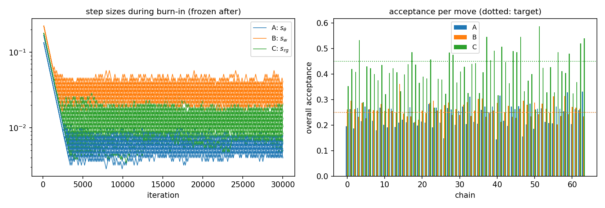

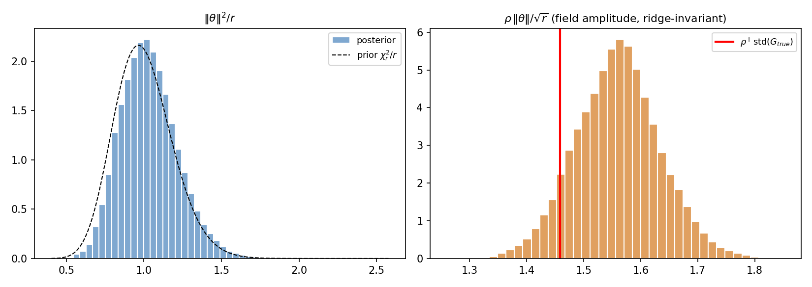

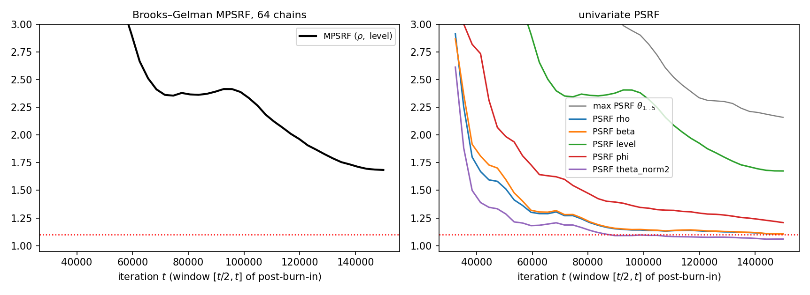

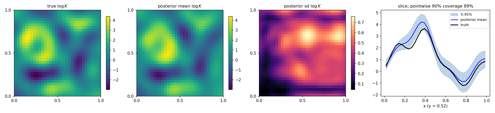

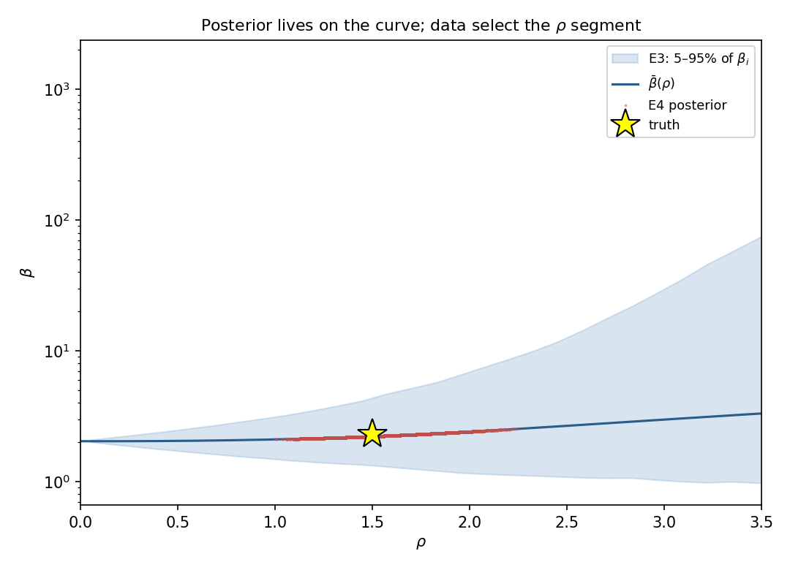

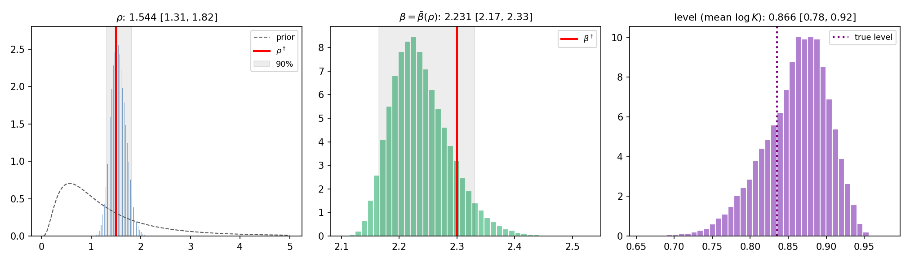

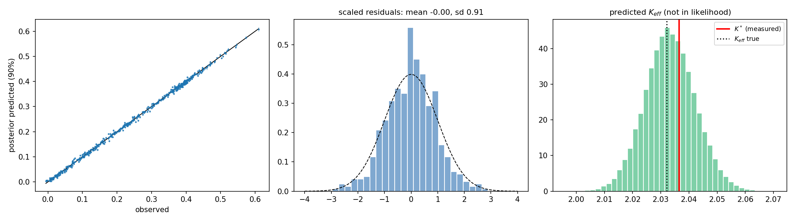

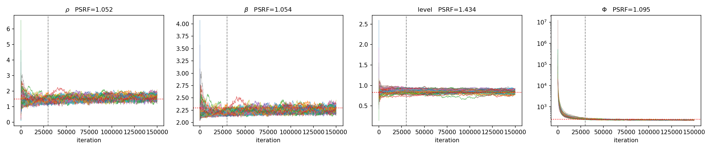

## combined

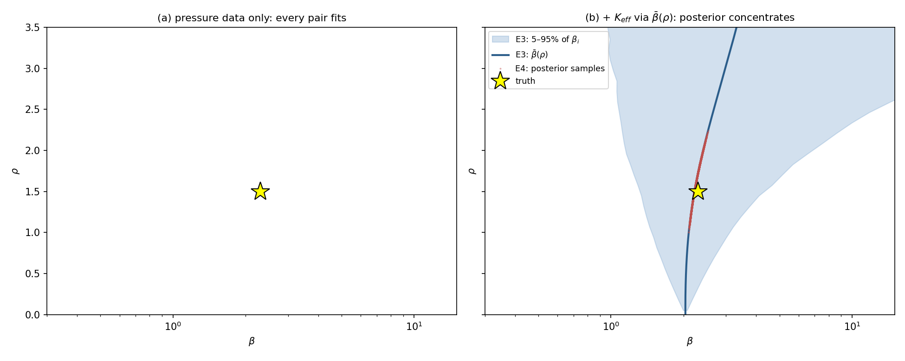
