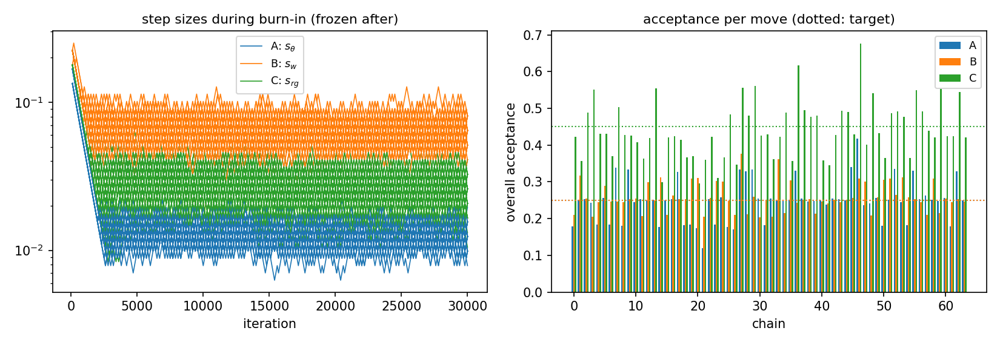
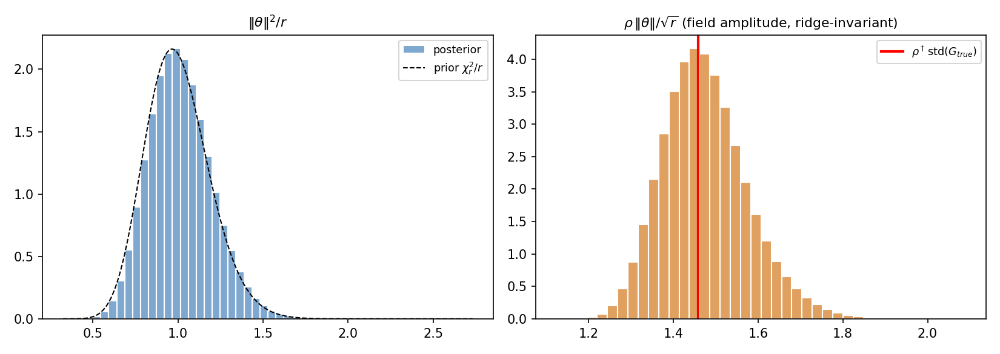
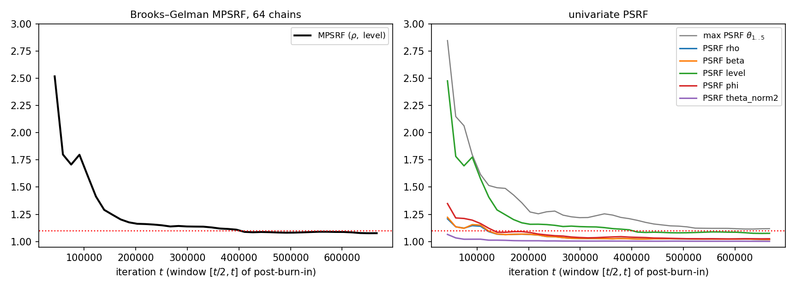
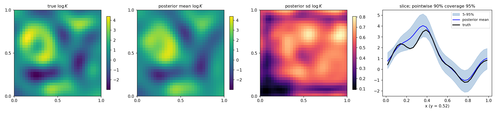
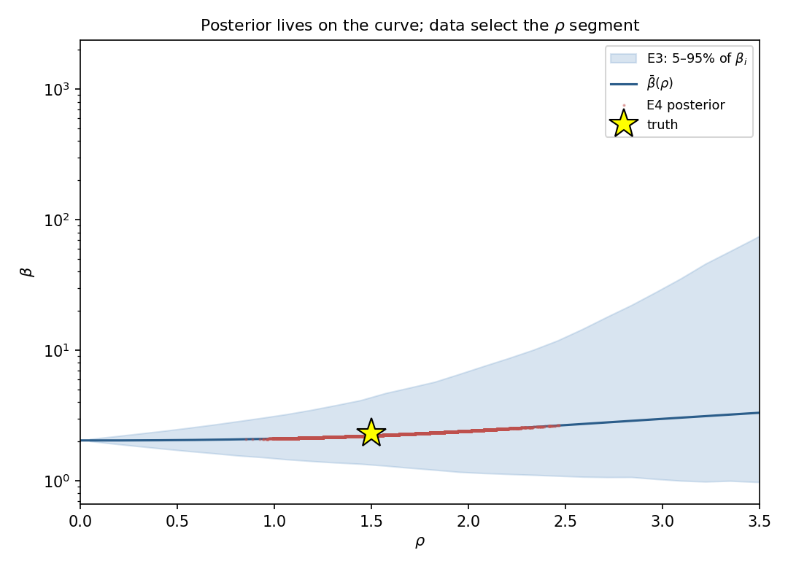
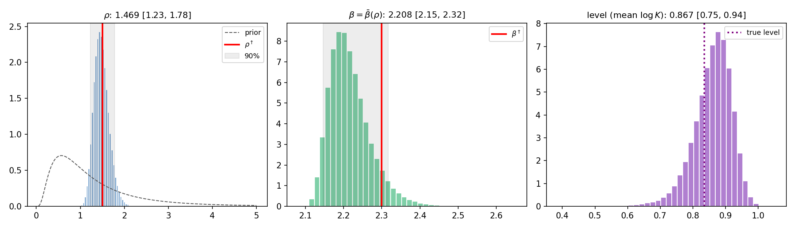
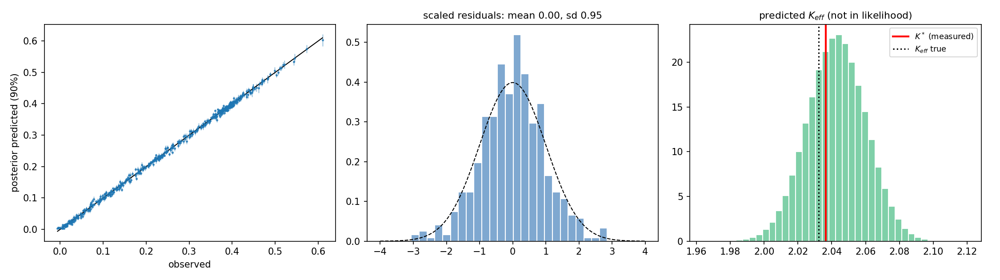
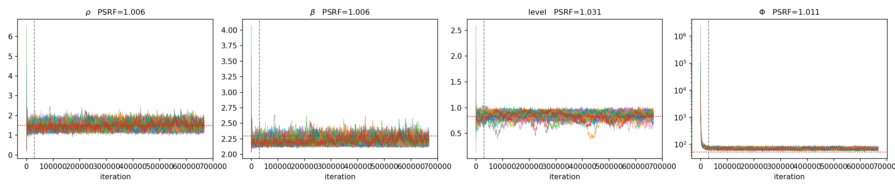
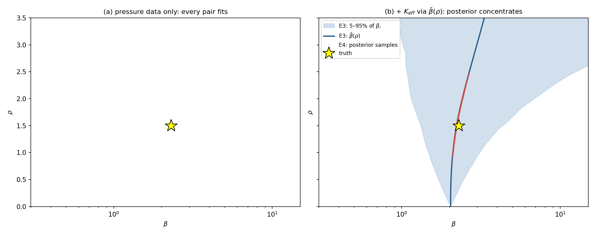

# betarho 2D - results summary

## e4_sampler

**e4_chains**

| chain | acc_A | acc_B | acc_C | s_theta | s_w | s_rg | rho_mean | level_mean | phi_mean |
|---|---|---|---|---|---|---|---|---|---|
| 0 | 0.1787 | 0.2105 | 0.4221 | 0.01555 | 0.08078 | 0.02601 | 1.485 | 0.8649 | 69.51 |
| 1 | 0.2515 | 0.3166 | 0.3563 | 0.0124 | 0.05134 | 0.03262 | 1.491 | 0.8677 | 68.9 |
| 2 | 0.2523 | 0.2554 | 0.4878 | 0.0124 | 0.06439 | 0.02073 | 1.481 | 0.8535 | 69.52 |
| 3 | 0.2433 | 0.2059 | 0.5517 | 0.0124 | 0.08078 | 0.01653 | 1.495 | 0.8246 | 70.32 |
| 4 | 0.1835 | 0.2439 | 0.4311 | 0.01555 | 0.06439 | 0.02601 | 1.461 | 0.8786 | 69.51 |
| 5 | 0.2566 | 0.2889 | 0.4302 | 0.0124 | 0.05134 | 0.02601 | 1.463 | 0.8685 | 69.56 |
| 6 | 0.1843 | 0.2463 | 0.37 | 0.01555 | 0.06439 | 0.03262 | 1.454 | 0.8754 | 69.18 |
| 7 | 0.3385 | 0.246 | 0.503 | 0.009882 | 0.06439 | 0.02073 | 1.453 | 0.8483 | 71.03 |
| 8 | 0.1812 | 0.2446 | 0.4271 | 0.01555 | 0.06439 | 0.02601 | 1.47 | 0.8587 | 70.2 |
| 9 | 0.3333 | 0.2534 | 0.425 | 0.009882 | 0.06439 | 0.02601 | 1.477 | 0.8625 | 69.33 |
| 10 | 0.2443 | 0.2541 | 0.4085 | 0.0124 | 0.06439 | 0.02601 | 1.522 | 0.8397 | 69.5 |
| 11 | 0.2529 | 0.2075 | 0.3629 | 0.0124 | 0.08078 | 0.03262 | 1.474 | 0.8681 | 69.55 |
| 12 | 0.2489 | 0.299 | 0.419 | 0.0124 | 0.05134 | 0.02601 | 1.49 | 0.8492 | 70.06 |
| 13 | 0.2516 | 0.2503 | 0.5548 | 0.0124 | 0.06439 | 0.01653 | 1.481 | 0.8564 | 70.27 |
| 14 | 0.1765 | 0.312 | 0.2996 | 0.01555 | 0.05134 | 0.04092 | 1.492 | 0.8641 | 69.71 |
| 15 | 0.2504 | 0.2102 | 0.4211 | 0.0124 | 0.08078 | 0.02601 | 1.482 | 0.8623 | 69.56 |
| 16 | 0.2522 | 0.2622 | 0.4234 | 0.0124 | 0.06439 | 0.02601 | 1.48 | 0.8608 | 68.89 |
| 17 | 0.3264 | 0.2527 | 0.4136 | 0.009882 | 0.06439 | 0.02601 | 1.507 | 0.8568 | 69.62 |
| 18 | 0.1827 | 0.2529 | 0.3663 | 0.01555 | 0.06439 | 0.03262 | 1.465 | 0.8743 | 69.87 |
| 19 | 0.1841 | 0.3082 | 0.3701 | 0.01555 | 0.05134 | 0.03262 | 1.455 | 0.8569 | 70.48 |
| 20 | 0.1737 | 0.3104 | 0.2961 | 0.01555 | 0.05134 | 0.04092 | 1.504 | 0.8653 | 69.53 |
| 21 | 0.1199 | 0.2051 | 0.3604 | 0.01951 | 0.08078 | 0.03262 | 1.478 | 0.8575 | 69.01 |
| 22 | 0.253 | 0.2562 | 0.4224 | 0.0124 | 0.06439 | 0.02601 | 1.484 | 0.8713 | 68.22 |
| 23 | 0.1839 | 0.3022 | 0.3113 | 0.01555 | 0.05134 | 0.04092 | 1.456 | 0.8657 | 70.72 |
| 24 | 0.2584 | 0.3005 | 0.3668 | 0.0124 | 0.05134 | 0.03262 | 1.466 | 0.8764 | 70.32 |
| 25 | 0.1764 | 0.2484 | 0.4827 | 0.01555 | 0.06439 | 0.02073 | 1.493 | 0.8611 | 68.6 |
| 26 | 0.1708 | 0.2095 | 0.3471 | 0.01555 | 0.08078 | 0.03262 | 1.512 | 0.8406 | 68.96 |
| 27 | 0.334 | 0.376 | 0.5553 | 0.009882 | 0.04092 | 0.01653 | 1.479 | 0.8655 | 69.72 |
| 28 | 0.3292 | 0.2118 | 0.481 | 0.009882 | 0.08078 | 0.02073 | 1.5 | 0.8659 | 70.72 |
| 29 | 0.3342 | 0.2597 | 0.5602 | 0.009882 | 0.06439 | 0.01653 | 1.472 | 0.8628 | 68.42 |
| 30 | 0.2543 | 0.2028 | 0.4263 | 0.0124 | 0.08078 | 0.02601 | 1.471 | 0.8683 | 70.55 |
| 31 | 0.182 | 0.249 | 0.4299 | 0.01555 | 0.06439 | 0.02601 | 1.461 | 0.8715 | 68.98 |
| 32 | 0.2541 | 0.2049 | 0.3624 | 0.0124 | 0.08078 | 0.03262 | 1.474 | 0.8819 | 68.82 |
| 33 | 0.2496 | 0.3614 | 0.4221 | 0.0124 | 0.04092 | 0.02601 | 1.481 | 0.8533 | 70.31 |
| 34 | 0.2507 | 0.2147 | 0.4889 | 0.0124 | 0.08078 | 0.02073 | 1.479 | 0.865 | 70.34 |
| 35 | 0.2505 | 0.3047 | 0.3567 | 0.0124 | 0.05134 | 0.03262 | 1.489 | 0.8761 | 68.72 |
| 36 | 0.3297 | 0.2429 | 0.6171 | 0.009882 | 0.06439 | 0.01318 | 1.487 | 0.8489 | 69.5 |
| 37 | 0.2551 | 0.2488 | 0.4951 | 0.0124 | 0.06439 | 0.02073 | 1.469 | 0.867 | 70.71 |
| 38 | 0.2466 | 0.2528 | 0.4763 | 0.0124 | 0.06439 | 0.02073 | 1.51 | 0.8479 | 69.45 |
| 39 | 0.2484 | 0.2138 | 0.4808 | 0.0124 | 0.08078 | 0.02073 | 1.501 | 0.8687 | 68.27 |
| 40 | 0.2494 | 0.2464 | 0.3586 | 0.0124 | 0.06439 | 0.03262 | 1.485 | 0.8657 | 69.3 |
| 41 | 0.2378 | 0.2408 | 0.3457 | 0.0124 | 0.06439 | 0.03262 | 1.519 | 0.813 | 69.85 |
| 42 | 0.2553 | 0.2508 | 0.4272 | 0.0124 | 0.06439 | 0.02601 | 1.469 | 0.8597 | 68.77 |
| 43 | 0.2534 | 0.2439 | 0.4931 | 0.0124 | 0.06439 | 0.02073 | 1.471 | 0.8624 | 68.66 |
| 44 | 0.2495 | 0.2519 | 0.4897 | 0.0124 | 0.06439 | 0.02073 | 1.479 | 0.8494 | 69.41 |
| 45 | 0.3397 | 0.2568 | 0.4294 | 0.009882 | 0.06439 | 0.02601 | 1.463 | 0.8489 | 69.72 |
| 46 | 0.417 | 0.3091 | 0.6761 | 0.007878 | 0.05134 | 0.0105 | 1.488 | 0.87 | 72.21 |
| 47 | 0.2368 | 0.3005 | 0.4015 | 0.0124 | 0.05134 | 0.02601 | 1.534 | 0.8096 | 69.5 |
| 48 | 0.2418 | 0.2091 | 0.5406 | 0.0124 | 0.08078 | 0.01653 | 1.517 | 0.8495 | 69.44 |
| 49 | 0.256 | 0.2575 | 0.432 | 0.0124 | 0.06439 | 0.02601 | 1.46 | 0.8623 | 69.81 |
| 50 | 0.1807 | 0.306 | 0.3643 | 0.01555 | 0.05134 | 0.03262 | 1.473 | 0.8487 | 69.76 |
| 51 | 0.2509 | 0.3083 | 0.4873 | 0.0124 | 0.05134 | 0.02073 | 1.489 | 0.8491 | 70.41 |
| 52 | 0.3352 | 0.2652 | 0.491 | 0.009882 | 0.06439 | 0.02073 | 1.476 | 0.878 | 69.87 |
| 53 | 0.244 | 0.3129 | 0.4773 | 0.0124 | 0.05134 | 0.02073 | 1.507 | 0.8345 | 69.69 |
| 54 | 0.1823 | 0.2573 | 0.3643 | 0.01555 | 0.06439 | 0.03262 | 1.468 | 0.8696 | 69.18 |
| 55 | 0.3297 | 0.2525 | 0.5501 | 0.009882 | 0.06439 | 0.01653 | 1.496 | 0.8766 | 69.95 |
| 56 | 0.2523 | 0.2448 | 0.4918 | 0.0124 | 0.06439 | 0.02073 | 1.477 | 0.8589 | 69.89 |
| 57 | 0.2633 | 0.2097 | 0.4398 | 0.0124 | 0.08078 | 0.02601 | 1.441 | 0.8843 | 70.34 |
| 58 | 0.2515 | 0.3081 | 0.4216 | 0.0124 | 0.05134 | 0.02601 | 1.483 | 0.8646 | 69.57 |
| 59 | 0.2487 | 0.2151 | 0.5525 | 0.0124 | 0.08078 | 0.01653 | 1.488 | 0.8559 | 69.46 |
| 60 | 0.2561 | 0.2539 | 0.4248 | 0.0124 | 0.06439 | 0.02601 | 1.476 | 0.8631 | 69.58 |
| 61 | 0.1789 | 0.2441 | 0.4235 | 0.01555 | 0.06439 | 0.02601 | 1.478 | 0.8613 | 69.46 |
| 62 | 0.328 | 0.253 | 0.5438 | 0.009882 | 0.06439 | 0.01653 | 1.51 | 0.875 | 68 |
| 63 | 0.249 | 0.2466 | 0.4202 | 0.0124 | 0.06439 | 0.02601 | 1.487 | 0.8426 | 68.93 |


**e4_stats**

| quantity | median | q05 | q95 | mean | sd | truth | z | covered | psrf | split_rhat | ess |
|---|---|---|---|---|---|---|---|---|---|---|---|
| rho | 1.469 | 1.229 | 1.783 | 1.482 | 0.1699 | 1.5 | -0.103 | True | 1.006 | 1.018 | 5207 |
| beta | 2.208 | 2.146 | 2.317 | 2.217 | 0.05374 | 2.3 | -1.546 | True | 1.006 | 1.018 | 5316 |
| level | 0.8674 | 0.7545 | 0.9418 | 0.8598 | 0.05998 | 0.835 | 0.4136 | True | 1.031 | 1.076 | 1788 |
| Phi | 69.3 | 61.73 | 78.55 | 69.61 | 5.13 | 51.66 | 3.5 | False | 1.011 | 1.025 | 4632 |
| theta_norm2/r | 1.004 | 0.7318 | 1.341 | 1.016 | 0.186 | 1 | 0.08386 | True | 1.001 | 1.002 | 3.352e+04 |
| theta_1 | -0.1727 | -0.5259 | 0.2551 | -0.1576 | 0.2427 | None | None | None | 1.03 | 1.072 | 1747 |
| theta_2 | 0.5576 | -0.02146 | 1.294 | 0.5873 | 0.4045 | None | None | None | 1.053 | 1.103 | 1235 |
| theta_3 | 1.685 | 1.07 | 2.422 | 1.708 | 0.4127 | None | None | None | 1.045 | 1.093 | 1506 |
| theta_4 | 0.9893 | 0.3867 | 1.599 | 0.9909 | 0.3705 | None | None | None | 1.053 | 1.115 | 1120 |
| theta_5 | 0.1713 | -0.1882 | 0.5268 | 0.1704 | 0.2175 | None | None | None | 1.033 | 1.061 | 1779 |


`tables/e4_sampler/e4_summary.json`

```json
{
 "n_chains": 64,
 "n_total": 667000,
 "n_burn": 30000,
 "thin": 100,
 "n_kept": 407680,
 "r": 57,
 "Kstar": 2.0364838809194694,
 "curve_statistic": "ratio_of_mean",
 "noise_floor": 51.65704666299076,
 "mean_phi": 69.6119079639612,
 "coverage90_logK": 0.9462890625,
 "mpsrf_final": 1.0770135948724748,
 "psrf_theta_lead_max": 1.1182837912570043,
 "rho": {
  "median": 1.4685716707582859,
  "lo": 1.2288949711523032,
  "hi": 1.7829002609824995,
  "mean": 1.482491804773054,
  "sd": 0.16994874058624493,
  "truth": 1.5,
  "covered": true,
  "z": -0.10302044702744373
 },
 "beta": {
  "median": 2.2082681491616265,
  "lo": 2.146042462098808,
  "hi": 2.3168716010742476,
  "mean": 2.2169093594177878,
  "sd": 0.05373556941983028,
  "truth": 2.3,
  "covered": true,
  "z": -1.5462875238751772
 },
 "level": {
  "median": 0.8673870694804116,
  "lo": 0.7544723402158597,
  "hi": 0.9418084022262672,
  "mean": 0.8597619526775028,
  "sd": 0.05997864195494429,
  "truth": 0.8349525043890009,
  "covered": true,
  "z": 0.4136380464755871
 },
 "info_limit_rel_sd": 0.0936585811581694,
 "rho_rel_sd": 0.11463722095398793,
 "minutes": null,
 "status": "extending to 667000"
}
```

















## combined


