# betarho 2D - results summary

## setup

**setup**

| truth_mode | n | ell | kle_method | kle_nq | kle_quadrature | kle_nq_rel_change | r | energy | mean_pointwise_var | n_obs | sigma_p | sigma_e | keff_true | keff_obs | level_true | Gbar | G_std | scaling_p_err | scaling_keff_err |
|---|---|---|---|---|---|---|---|---|---|---|---|---|---|---|---|---|---|---|---|
| standardized | 32 | 0.1 | dense |  |  |  | 57 | 0.9516 | 0.9516 | 512 | 0.005757 | 0.05 | 1.991 | 1.995 | 0.8329 | 1.388e-17 | 1 | 3.964e-14 | 3.83e-14 |


`tables/setup/setup.json`

```json
{
 "truth_mode": "standardized",
 "n": 32,
 "ell": 0.1,
 "kle_method": "dense",
 "kle_nq": "",
 "kle_quadrature": "",
 "kle_nq_rel_change": "",
 "r": 57,
 "energy": 0.9516350366489337,
 "mean_pointwise_var": 0.9516350366489335,
 "n_obs": 512,
 "sigma_p": 0.005756749086700425,
 "sigma_e": 0.05,
 "keff_true": 1.9906862938401289,
 "keff_obs": 1.9949341170501156,
 "level_true": 0.8329091229351038,
 "Gbar": 1.3877787807814457e-17,
 "G_std": 1.0,
 "scaling_p_err": 3.963777714871445e-14,
 "scaling_keff_err": 3.83026943495679e-14
}
```

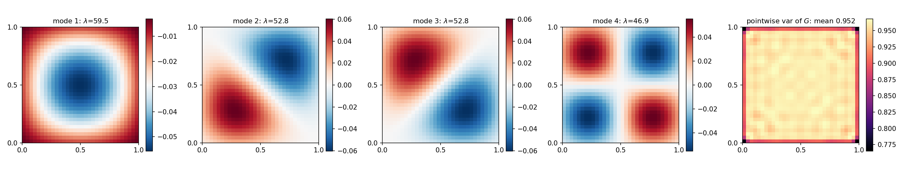

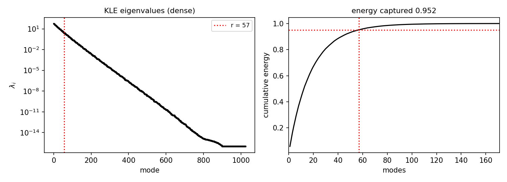

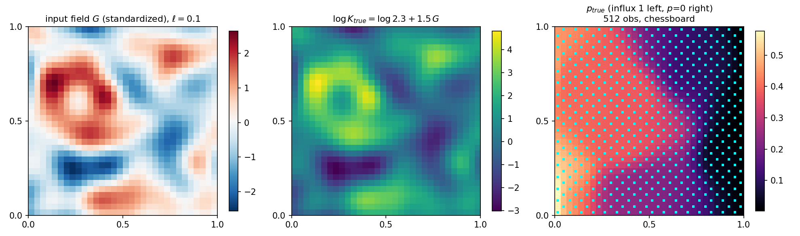

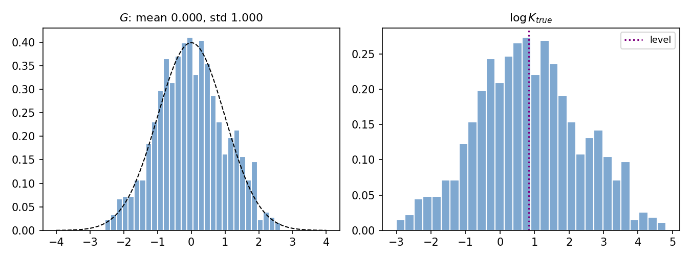

## e2_grid

**grid_table**

| beta | rho | rms_over_sigma | mean_phi | best_phi | acc | theta_norm2_over_r | step |
|---|---|---|---|---|---|---|---|
| 0.5 | 0.5 | 1.394 | 108.6 | 88.78 | 0.2309 | 7.511 | 0.03708 |
| 0.5 | 1 | 1.186 | 85.24 | 68.23 | 0.2032 | 2.472 | 0.0212 |
| 0.5 | 1.5 | 1.144 | 81.16 | 64.65 | 0.2433 | 1.348 | 0.01212 |
| 0.5 | 2.25 | 1.208 | 89.22 | 70.6 | 0.2312 | 0.7327 | 0.00797 |
| 0.5 | 3 | 1.198 | 89.29 | 75.23 | 0.2762 | 0.4153 | 0.00524 |
| 1 | 0.5 | 1.361 | 102.7 | 88.81 | 0.2396 | 5.306 | 0.03708 |
| 1 | 1 | 1.17 | 82.29 | 71.35 | 0.238 | 1.95 | 0.01843 |
| 1 | 1.5 | 1.164 | 84.97 | 72.52 | 0.1955 | 1.034 | 0.01394 |
| 1 | 2.25 | 1.234 | 93.57 | 73.56 | 0.2355 | 0.524 | 0.00797 |
| 1 | 3 | 1.212 | 91.02 | 71.24 | 0.2135 | 0.3754 | 0.006026 |
| 2.3 | 0.5 | 1.367 | 104.7 | 90.9 | 0.2055 | 4.304 | 0.04264 |
| 2.3 | 1 | 1.174 | 83.87 | 67.07 | 0.249 | 1.657 | 0.01843 |
| 2.3 | 1.5 | 1.146 | 80.98 | 67.36 | 0.2129 | 1.017 | 0.01394 |
| 2.3 | 2.25 | 1.179 | 88.86 | 64.15 | 0.2117 | 0.4304 | 0.009165 |
| 2.3 | 3 | 1.237 | 92.79 | 71.49 | 0.2354 | 0.3188 | 0.00575 |
| 5 | 0.5 | 1.398 | 108.7 | 93.96 | 0.2441 | 4.932 | 0.03708 |
| 5 | 1 | 1.202 | 86.6 | 73.9 | 0.2519 | 1.87 | 0.01843 |
| 5 | 1.5 | 1.183 | 84.44 | 72.6 | 0.2802 | 0.9815 | 0.01054 |
| 5 | 2.25 | 1.151 | 81.63 | 67.73 | 0.27 | 0.6653 | 0.00693 |
| 5 | 3 | 1.323 | 110.5 | 82.76 | 0.2403 | 0.3665 | 0.006026 |
| 10 | 0.5 | 1.405 | 109 | 94.51 | 0.2438 | 6.911 | 0.03708 |
| 10 | 1 | 1.233 | 91.6 | 76.71 | 0.211 | 2.285 | 0.0212 |
| 10 | 1.5 | 1.213 | 90.84 | 72.98 | 0.2522 | 1.198 | 0.01212 |
| 10 | 2.25 | 1.181 | 85.77 | 70 | 0.295 | 0.5881 | 0.00693 |
| 10 | 3 | 1.21 | 91.8 | 71.56 | 0.2457 | 0.5951 | 0.00575 |


`tables/e2_grid/grid_summary.json`

```json
{
 "truth_mode": "standardized",
 "r": 57,
 "n_chains": 25,
 "n_iter": 50000,
 "n_burn": 10000,
 "noise_floor": 47.95928888382515,
 "rms_over_sigma": [
  1.143706468751318,
  1.4052796853240606
 ],
 "best_phi": [
  64.14952032477969,
  94.51162443156916
 ],
 "mean_phi": [
  80.9826336614178,
  110.51908222491022
 ],
 "acc": [
  0.1955,
  0.29504
 ],
 "minutes": null
}
```

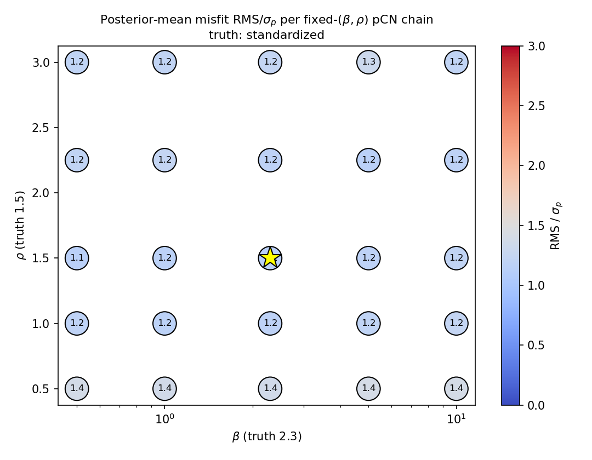

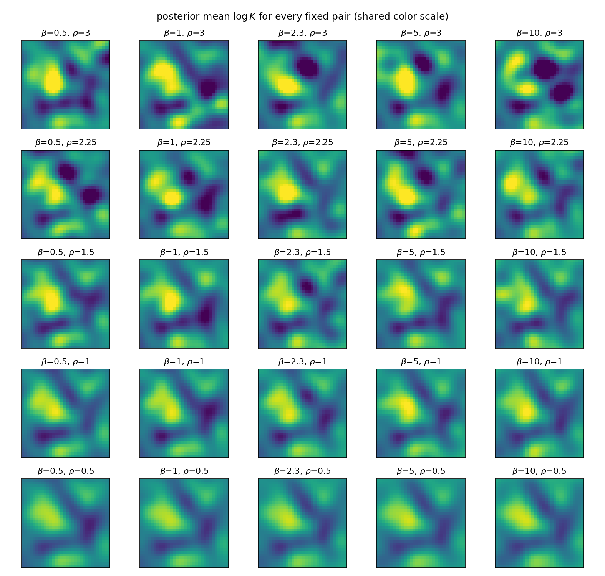

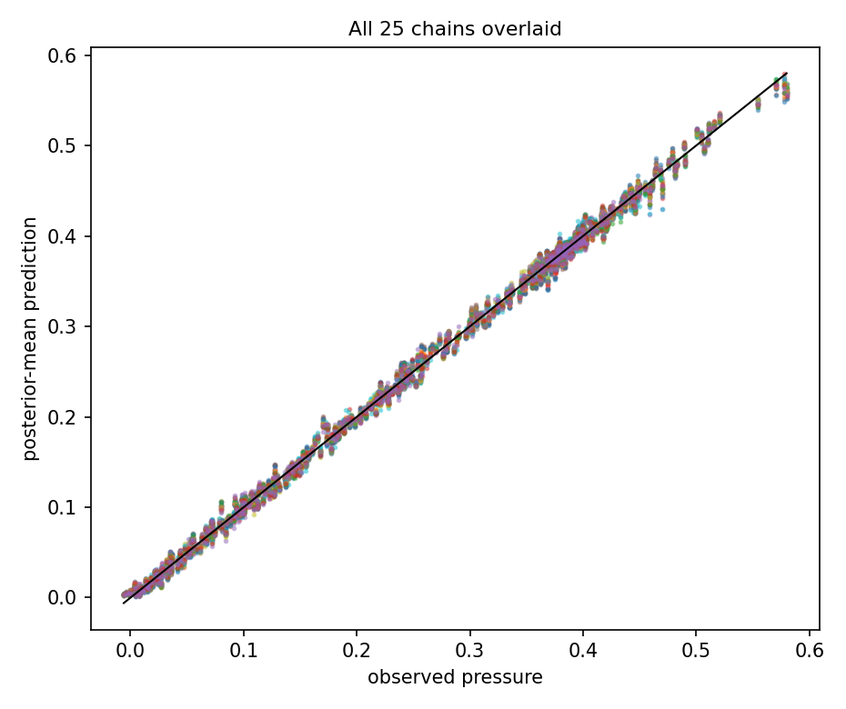

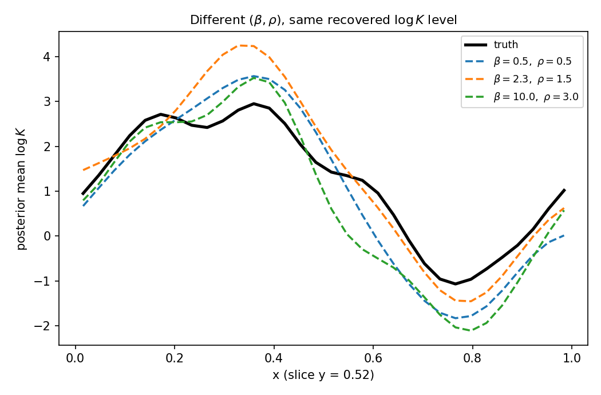

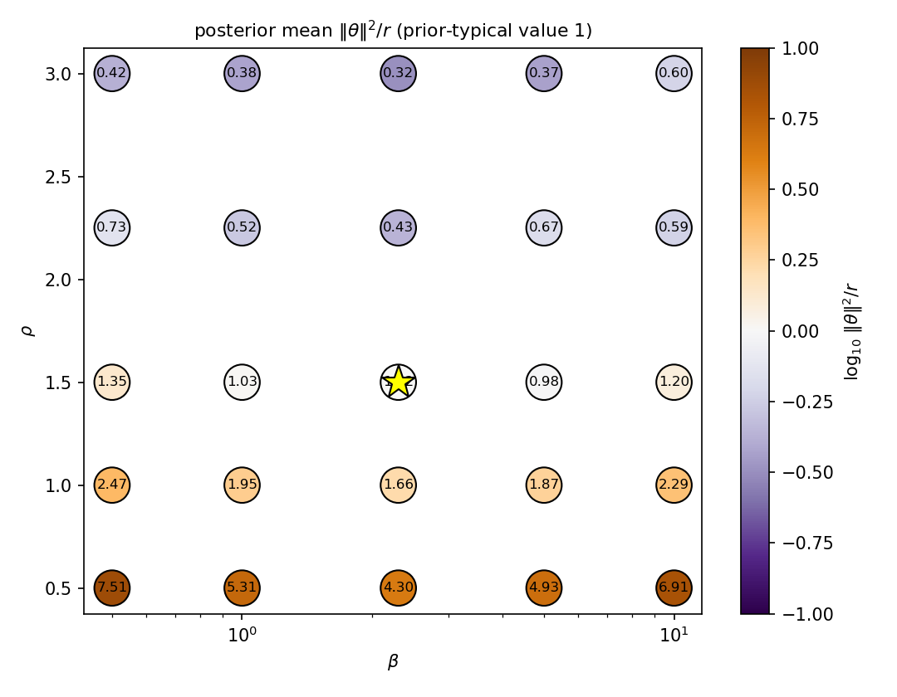

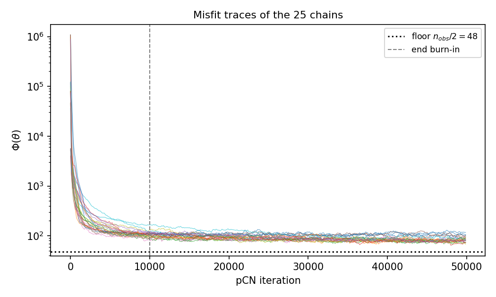

## e3_curve

**curve_table**

| rho | f_mean | f_se | beta_ratio_of_mean | beta_mean_of_ratio | beta_median | beta_std | beta_q05 | beta_q95 | keff_relstd |
|---|---|---|---|---|---|---|---|---|---|
| 0.05 | 0.9999 | 0.0003536 | 1.995 | 1.995 | 1.994 | 0.02258 | 1.958 | 2.033 | 0.01132 |
| 0.1769 | 0.9988 | 0.001252 | 1.997 | 2.001 | 1.997 | 0.08021 | 1.869 | 2.136 | 0.04012 |
| 0.3038 | 0.9966 | 0.002154 | 2.002 | 2.011 | 2.005 | 0.1389 | 1.789 | 2.249 | 0.06917 |
| 0.4308 | 0.9934 | 0.003063 | 2.008 | 2.028 | 2.02 | 0.1996 | 1.716 | 2.375 | 0.09867 |
| 0.5577 | 0.9891 | 0.003982 | 2.017 | 2.05 | 2.038 | 0.263 | 1.643 | 2.519 | 0.1288 |
| 0.6846 | 0.9836 | 0.004913 | 2.028 | 2.08 | 2.058 | 0.3304 | 1.578 | 2.679 | 0.1598 |
| 0.8115 | 0.9768 | 0.005858 | 2.042 | 2.117 | 2.091 | 0.4031 | 1.516 | 2.842 | 0.1919 |
| 0.9385 | 0.9686 | 0.006821 | 2.06 | 2.163 | 2.123 | 0.4828 | 1.466 | 3.043 | 0.2253 |
| 1.065 | 0.959 | 0.007803 | 2.08 | 2.22 | 2.162 | 0.572 | 1.429 | 3.268 | 0.2604 |
| 1.192 | 0.9479 | 0.008808 | 2.105 | 2.289 | 2.21 | 0.6745 | 1.367 | 3.52 | 0.2973 |
| 1.319 | 0.9354 | 0.009837 | 2.133 | 2.373 | 2.257 | 0.796 | 1.311 | 3.778 | 0.3365 |
| 1.446 | 0.9216 | 0.01089 | 2.165 | 2.474 | 2.308 | 0.9463 | 1.269 | 4.144 | 0.3781 |
| 1.573 | 0.9064 | 0.01196 | 2.201 | 2.597 | 2.382 | 1.142 | 1.231 | 4.58 | 0.4222 |
| 1.7 | 0.8901 | 0.01304 | 2.241 | 2.748 | 2.467 | 1.414 | 1.192 | 4.99 | 0.4689 |
| 1.827 | 0.8728 | 0.01413 | 2.286 | 2.933 | 2.57 | 1.814 | 1.148 | 5.609 | 0.5182 |
| 1.954 | 0.8547 | 0.01523 | 2.334 | 3.164 | 2.669 | 2.432 | 1.124 | 6.297 | 0.5702 |
| 2.081 | 0.8359 | 0.01632 | 2.387 | 3.455 | 2.801 | 3.418 | 1.088 | 7.245 | 0.6247 |
| 2.208 | 0.8167 | 0.01741 | 2.443 | 3.826 | 2.932 | 5.016 | 1.05 | 8.402 | 0.682 |
| 2.335 | 0.7972 | 0.01849 | 2.503 | 4.309 | 3.082 | 7.623 | 1.023 | 9.965 | 0.7422 |
| 2.462 | 0.7776 | 0.01957 | 2.565 | 4.948 | 3.257 | 11.89 | 0.9987 | 11.75 | 0.8055 |
| 2.588 | 0.7582 | 0.02067 | 2.631 | 5.809 | 3.426 | 18.87 | 0.9763 | 13.96 | 0.8724 |
| 2.715 | 0.7391 | 0.02179 | 2.699 | 6.994 | 3.647 | 30.32 | 0.96 | 16.96 | 0.9434 |
| 2.842 | 0.7205 | 0.02294 | 2.769 | 8.658 | 3.865 | 49.15 | 0.9228 | 20.25 | 1.019 |
| 2.969 | 0.7027 | 0.02415 | 2.839 | 11.04 | 4.12 | 80.18 | 0.8951 | 25.31 | 1.1 |
| 3.096 | 0.6856 | 0.02541 | 2.91 | 14.51 | 4.382 | 131.4 | 0.8652 | 29.35 | 1.186 |
| 3.223 | 0.6695 | 0.02675 | 2.98 | 19.67 | 4.686 | 216.1 | 0.8693 | 37.14 | 1.279 |
| 3.35 | 0.6544 | 0.02818 | 3.049 | 27.44 | 5.037 | 356.5 | 0.8736 | 48.43 | 1.378 |
| 3.477 | 0.6403 | 0.02971 | 3.115 | 39.34 | 5.457 | 589.5 | 0.8545 | 61.87 | 1.485 |
| 3.604 | 0.6275 | 0.03135 | 3.179 | 57.78 | 5.983 | 976.6 | 0.8625 | 77.9 | 1.599 |
| 3.731 | 0.6158 | 0.03311 | 3.239 | 86.69 | 6.493 | 1621 | 0.8671 | 102.2 | 1.72 |
| 3.858 | 0.6054 | 0.03501 | 3.295 | 132.4 | 7.143 | 2694 | 0.8797 | 134.6 | 1.85 |
| 3.985 | 0.5962 | 0.03706 | 3.346 | 205.5 | 7.764 | 4484 | 0.8833 | 173.5 | 1.989 |
| 4.112 | 0.5882 | 0.03927 | 3.391 | 323 | 8.573 | 7473 | 0.8897 | 235.5 | 2.136 |
| 4.238 | 0.5815 | 0.04166 | 3.43 | 513.1 | 9.418 | 1.247e+04 | 0.9068 | 312.8 | 2.292 |
| 4.365 | 0.5761 | 0.04424 | 3.463 | 822.6 | 10.62 | 2.082e+04 | 0.929 | 389.3 | 2.457 |
| 4.492 | 0.5719 | 0.04704 | 3.488 | 1329 | 11.53 | 3.48e+04 | 0.9296 | 499.3 | 2.632 |
| 4.619 | 0.569 | 0.05006 | 3.506 | 2159 | 12.9 | 5.821e+04 | 0.925 | 657.5 | 2.815 |
| 4.746 | 0.5674 | 0.05333 | 3.516 | 3528 | 14.48 | 9.745e+04 | 0.9234 | 874.9 | 3.008 |
| 4.873 | 0.5671 | 0.05687 | 3.518 | 5790 | 16.26 | 1.633e+05 | 0.9183 | 1164 | 3.209 |
| 5 | 0.5681 | 0.06069 | 3.512 | 9539 | 18.28 | 2.738e+05 | 0.9058 | 1520 | 3.419 |


`tables/e3_curve/curve_summary.json`

```json
{
 "Kstar": 1.9949341170501156,
 "statistic": "ratio_of_mean",
 "n_real": 1024,
 "n_rho": 40,
 "rho_range": [
  0.05,
  5.0
 ],
 "beta_bar_at_rho_true": 2.179554111803157,
 "beta_true": 2.3,
 "rel_err_at_truth": -0.052367777476888255,
 "beta_bar_at_0": 1.9949341170501156,
 "band_at_rho_true": [
  1.2692138592399598,
  4.144096216651686
 ],
 "minutes": 2.551134546597799,
 "cholesky_vs_kle_beta_at_truth": 0.011413313210142162
}
```

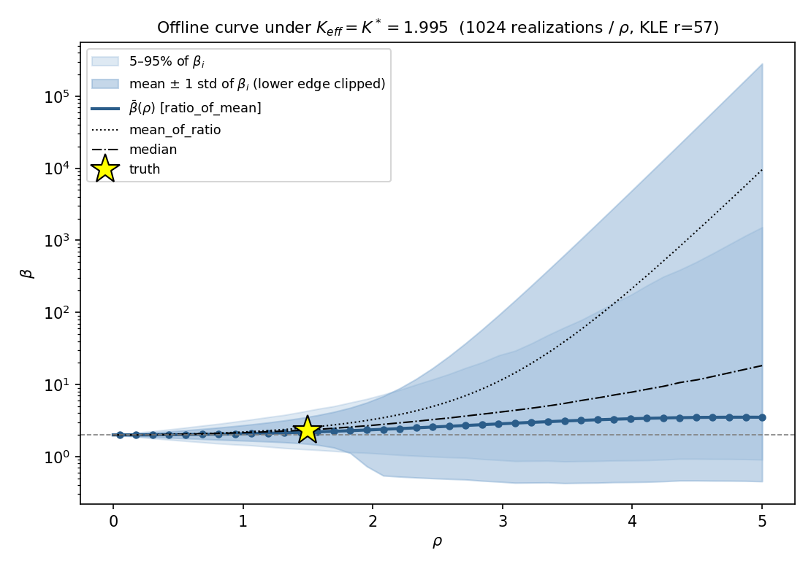

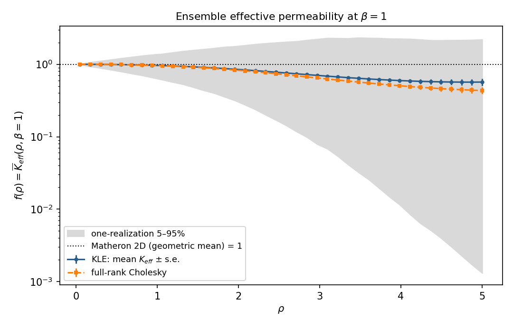

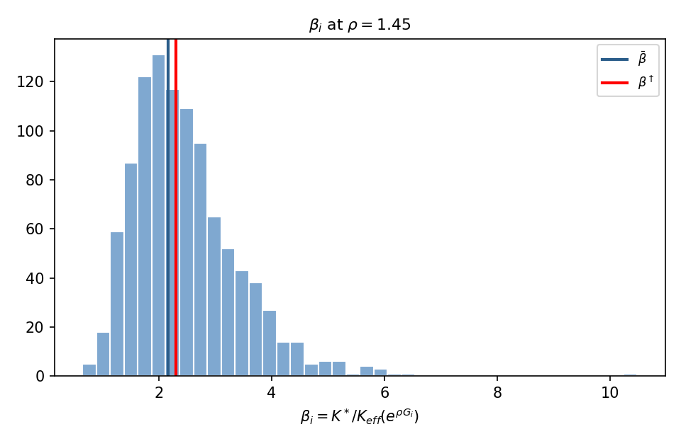

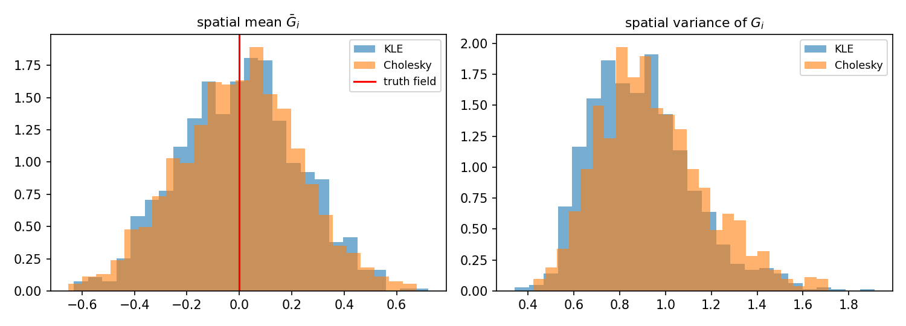

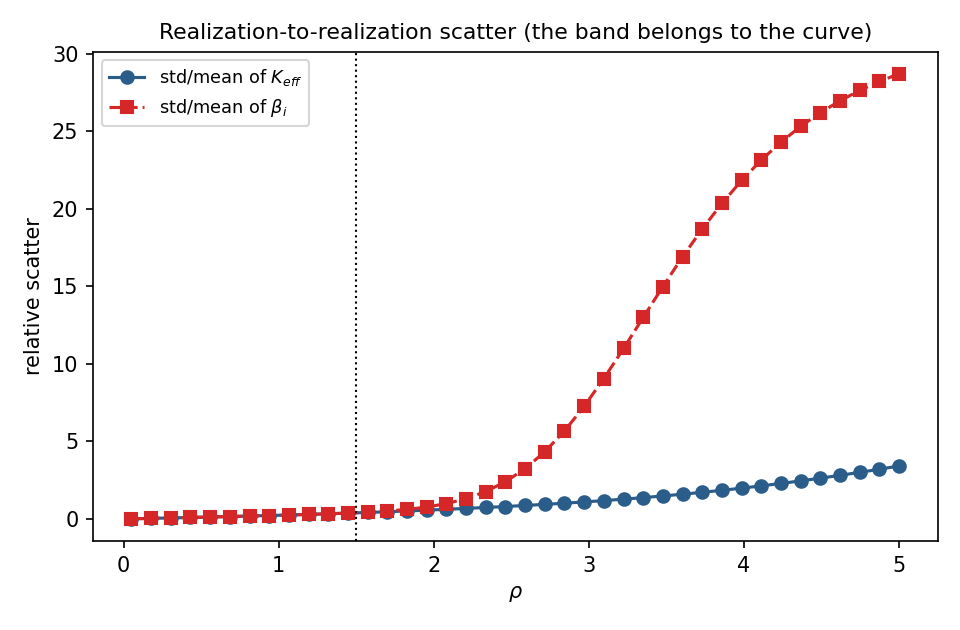

## e4_prior_test

**prior_test**

| n_samples | frob_chain | frob_reference | gbar_sd_chain | gbar_sd_reference | w_mean | w_sd | w_mean_target | w_sd_target | ks_w_p | ks_gbar_p | prior_mass_above_rho_max |
|---|---|---|---|---|---|---|---|---|---|---|---|
| 19200 | 0.05253 | 0.05576 | 0.2309 | 0.2273 | -0.04203 | 0.9529 | -0.04054 | 0.9546 | 0.08524 | 0.6671 | 0.01594 |


`tables/e4_prior_test/prior_test.json`

```json
{
 "n_samples": 19200,
 "frob_chain": 0.05253412908298967,
 "frob_reference": 0.05576232726777096,
 "gbar_sd_chain": 0.23088864310939747,
 "gbar_sd_reference": 0.22727585033728628,
 "w_mean": -0.04202678188543201,
 "w_sd": 0.952862821501038,
 "w_mean_target": -0.04054468066749765,
 "w_sd_target": 0.9546468460035353,
 "ks_w_p": 0.08524259385772814,
 "ks_gbar_p": 0.6670676695599848,
 "prior_mass_above_rho_max": 0.01593979198110751,
 "acc": [
  1.0,
  0.9853541666666666,
  0.4486593137254902
 ]
}
```

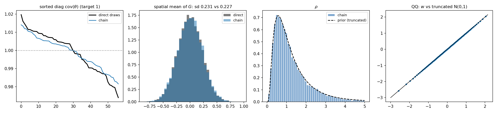

## e4_sampler

**e4_chains**

| chain | acc_A | acc_B | acc_C | s_theta | s_w | s_rg | rho_mean | level_mean | phi_mean |
|---|---|---|---|---|---|---|---|---|---|
| 0 | 0.3115 | 0.2387 | 0.4282 | 0.009882 | 0.06439 | 0.02601 | 1.518 | 0.875 | 79.73 |
| 1 | 0.2407 | 0.2564 | 0.427 | 0.0124 | 0.06439 | 0.02601 | 1.516 | 0.8317 | 80.82 |
| 2 | 0.1877 | 0.2459 | 0.3872 | 0.01555 | 0.06439 | 0.03262 | 1.486 | 0.8744 | 80.26 |
| 3 | 0.2982 | 0.2615 | 0.4709 | 0.009882 | 0.06439 | 0.02073 | 1.549 | 0.8268 | 80.65 |
| 4 | 0.2469 | 0.282 | 0.4344 | 0.0124 | 0.05134 | 0.02601 | 1.496 | 0.888 | 81.14 |
| 5 | 0.2909 | 0.2221 | 0.4684 | 0.009882 | 0.08078 | 0.02073 | 1.556 | 0.7894 | 79.68 |
| 6 | 0.1905 | 0.2921 | 0.3374 | 0.01555 | 0.05134 | 0.04092 | 1.475 | 0.8489 | 81.88 |
| 7 | 0.2438 | 0.2098 | 0.3676 | 0.0124 | 0.08078 | 0.03262 | 1.535 | 0.9241 | 83.96 |
| 8 | 0.1717 | 0.2529 | 0.3573 | 0.01555 | 0.06439 | 0.03262 | 1.586 | 0.8108 | 78.82 |
| 9 | 0.2415 | 0.255 | 0.4295 | 0.0124 | 0.06439 | 0.02601 | 1.512 | 0.8653 | 79.08 |
| 10 | 0.2497 | 0.1842 | 0.3788 | 0.0124 | 0.1013 | 0.03262 | 1.504 | 0.9068 | 79.74 |
| 11 | 0.2447 | 0.255 | 0.3715 | 0.0124 | 0.06439 | 0.03262 | 1.526 | 0.8951 | 80.09 |
| 12 | 0.1681 | 0.2996 | 0.4 | 0.01555 | 0.05134 | 0.02601 | 1.61 | 0.8325 | 77.74 |
| 13 | 0.2561 | 0.2839 | 0.4416 | 0.0124 | 0.05134 | 0.02601 | 1.477 | 0.8905 | 79.65 |
| 14 | 0.2517 | 0.3052 | 0.4346 | 0.0124 | 0.05134 | 0.02601 | 1.491 | 0.8835 | 80.96 |
| 15 | 0.3153 | 0.3075 | 0.4871 | 0.009882 | 0.05134 | 0.02073 | 1.505 | 0.8581 | 79.05 |
| 16 | 0.2247 | 0.2646 | 0.3448 | 0.0124 | 0.06439 | 0.03262 | 1.617 | 0.8703 | 80.06 |
| 17 | 0.2491 | 0.2895 | 0.431 | 0.0124 | 0.05134 | 0.02601 | 1.497 | 0.8948 | 81.41 |
| 18 | 0.2543 | 0.2146 | 0.3885 | 0.0124 | 0.08078 | 0.03262 | 1.468 | 0.8678 | 82.66 |
| 19 | 0.248 | 0.2374 | 0.3844 | 0.0124 | 0.06439 | 0.03262 | 1.483 | 0.8528 | 80.17 |
| 20 | 0.2388 | 0.2555 | 0.4186 | 0.0124 | 0.06439 | 0.02601 | 1.545 | 0.8969 | 81.4 |
| 21 | 0.2322 | 0.235 | 0.3594 | 0.0124 | 0.06439 | 0.03262 | 1.563 | 0.8317 | 84.44 |
| 22 | 0.166 | 0.2362 | 0.3625 | 0.01555 | 0.06439 | 0.03262 | 1.566 | 0.7903 | 79.94 |
| 23 | 0.2361 | 0.2685 | 0.4817 | 0.0124 | 0.06439 | 0.02073 | 1.524 | 0.8222 | 81.59 |
| 24 | 0.169 | 0.2678 | 0.4036 | 0.01555 | 0.06439 | 0.02601 | 1.58 | 0.8546 | 79.94 |
| 25 | 0.1694 | 0.3385 | 0.3602 | 0.01555 | 0.04092 | 0.03262 | 1.559 | 0.8472 | 83.1 |
| 26 | 0.2293 | 0.2289 | 0.4128 | 0.0124 | 0.06439 | 0.02601 | 1.561 | 0.8117 | 79.41 |
| 27 | 0.2474 | 0.2535 | 0.3843 | 0.0124 | 0.06439 | 0.03262 | 1.484 | 0.8458 | 82.05 |
| 28 | 0.1872 | 0.2785 | 0.3745 | 0.01555 | 0.05134 | 0.03262 | 1.508 | 0.909 | 78.01 |
| 29 | 0.235 | 0.3094 | 0.3613 | 0.0124 | 0.05134 | 0.03262 | 1.55 | 0.8339 | 81.73 |
| 30 | 0.3117 | 0.2509 | 0.4819 | 0.009882 | 0.06439 | 0.02073 | 1.524 | 0.8866 | 80.68 |
| 31 | 0.2257 | 0.2996 | 0.4722 | 0.0124 | 0.05134 | 0.02073 | 1.545 | 0.81 | 79.53 |
| 32 | 0.3054 | 0.2203 | 0.4791 | 0.009882 | 0.08078 | 0.02073 | 1.521 | 0.8844 | 81.5 |
| 33 | 0.3014 | 0.2891 | 0.4838 | 0.009882 | 0.05134 | 0.02073 | 1.522 | 0.783 | 81.89 |
| 34 | 0.257 | 0.1686 | 0.4408 | 0.0124 | 0.1013 | 0.02601 | 1.474 | 0.8999 | 80.49 |
| 35 | 0.244 | 0.2523 | 0.4305 | 0.0124 | 0.06439 | 0.02601 | 1.501 | 0.8833 | 79.02 |
| 36 | 0.1986 | 0.2316 | 0.395 | 0.01555 | 0.06439 | 0.03262 | 1.454 | 0.8997 | 79.66 |
| 37 | 0.2462 | 0.3511 | 0.4237 | 0.0124 | 0.04092 | 0.02601 | 1.523 | 0.8709 | 78.78 |
| 38 | 0.2594 | 0.2419 | 0.3982 | 0.0124 | 0.06439 | 0.03262 | 1.448 | 0.8896 | 81.78 |
| 39 | 0.2445 | 0.3016 | 0.4795 | 0.0124 | 0.05134 | 0.02073 | 1.52 | 0.8744 | 79.09 |
| 40 | 0.2452 | 0.2675 | 0.3783 | 0.0124 | 0.06439 | 0.03262 | 1.52 | 0.843 | 78.74 |
| 41 | 0.2628 | 0.2463 | 0.4483 | 0.0124 | 0.06439 | 0.02601 | 1.453 | 0.9209 | 80.97 |
| 42 | 0.24 | 0.2926 | 0.4126 | 0.0124 | 0.05134 | 0.02601 | 1.567 | 0.8948 | 79.18 |
| 43 | 0.2484 | 0.2568 | 0.4884 | 0.0124 | 0.06439 | 0.02073 | 1.505 | 0.8594 | 77.38 |
| 44 | 0.3249 | 0.2185 | 0.4523 | 0.009882 | 0.08078 | 0.02601 | 1.446 | 0.8482 | 79.35 |
| 45 | 0.312 | 0.2646 | 0.5381 | 0.009882 | 0.06439 | 0.01653 | 1.522 | 0.8284 | 81.22 |
| 46 | 0.1849 | 0.3385 | 0.3858 | 0.01555 | 0.04092 | 0.03262 | 1.477 | 0.8566 | 80.59 |
| 47 | 0.1929 | 0.2928 | 0.3936 | 0.01555 | 0.05134 | 0.03262 | 1.457 | 0.902 | 81.28 |
| 48 | 0.2368 | 0.2391 | 0.3684 | 0.0124 | 0.08078 | 0.03262 | 1.534 | 0.8173 | 80.79 |
| 49 | 0.1686 | 0.208 | 0.4088 | 0.01555 | 0.08078 | 0.02601 | 1.575 | 0.813 | 80.75 |
| 50 | 0.1813 | 0.2615 | 0.3706 | 0.01555 | 0.06439 | 0.03262 | 1.517 | 0.8512 | 79 |
| 51 | 0.1632 | 0.3268 | 0.2996 | 0.01555 | 0.04092 | 0.04092 | 1.64 | 0.8487 | 78.2 |
| 52 | 0.3238 | 0.2242 | 0.5515 | 0.009882 | 0.06439 | 0.01653 | 1.474 | 0.9119 | 78.51 |
| 53 | 0.2435 | 0.1947 | 0.5464 | 0.0124 | 0.1013 | 0.01653 | 1.486 | 0.825 | 81.56 |
| 54 | 0.282 | 0.2749 | 0.5577 | 0.009882 | 0.05134 | 0.01318 | 1.626 | 0.771 | 79.9 |
| 55 | 0.3024 | 0.2943 | 0.5298 | 0.009882 | 0.05134 | 0.01653 | 1.545 | 0.8836 | 79.81 |
| 56 | 0.3043 | 0.2599 | 0.5367 | 0.009882 | 0.06439 | 0.01653 | 1.524 | 0.8553 | 79.69 |
| 57 | 0.2477 | 0.2919 | 0.3762 | 0.0124 | 0.05134 | 0.03262 | 1.508 | 0.8626 | 80.41 |
| 58 | 0.2514 | 0.2477 | 0.3868 | 0.0124 | 0.06439 | 0.03262 | 1.476 | 0.8825 | 80.23 |
| 59 | 0.293 | 0.2731 | 0.5163 | 0.009882 | 0.06439 | 0.01653 | 1.585 | 0.8537 | 78.46 |
| 60 | 0.2423 | 0.2507 | 0.4765 | 0.0124 | 0.06439 | 0.02073 | 1.534 | 0.8714 | 80.43 |
| 61 | 0.2443 | 0.2305 | 0.4281 | 0.0124 | 0.08078 | 0.02601 | 1.513 | 0.8721 | 79.58 |
| 62 | 0.2206 | 0.2524 | 0.4022 | 0.0124 | 0.06439 | 0.02601 | 1.592 | 0.7708 | 78.21 |
| 63 | 0.2534 | 0.3503 | 0.3862 | 0.0124 | 0.04092 | 0.03262 | 1.475 | 0.8783 | 79.3 |


**e4_stats**

| quantity | median | q05 | q95 | mean | sd | truth | z | covered | psrf | split_rhat | ess |
|---|---|---|---|---|---|---|---|---|---|---|---|
| rho | 1.509 | 1.259 | 1.831 | 1.522 | 0.1747 | 1.5 | 0.1268 | True | 1.035 | 1.065 | 2487 |
| beta | 2.182 | 2.119 | 2.287 | 2.19 | 0.05246 | 2.3 | -2.101 | False | 1.036 | 1.067 | 2529 |
| level | 0.8672 | 0.7397 | 0.9476 | 0.8583 | 0.06632 | 0.8329 | 0.3828 | True | 1.201 | 1.343 | 681.8 |
| Phi | 79.92 | 72.28 | 89.27 | 80.24 | 5.177 | 47.96 | 6.235 | False | 1.04 | 1.075 | 1709 |
| theta_norm2/r | 1.004 | 0.7305 | 1.343 | 1.017 | 0.1871 | 1 | 0.08988 | True | 1.005 | 1.013 | 7252 |
| theta_1 | -0.2543 | -0.616 | 0.2306 | -0.233 | 0.2575 | None | None | None | 1.196 | 1.356 | 724.3 |
| theta_2 | 0.8342 | 0.1916 | 1.574 | 0.8501 | 0.4311 | None | None | None | 1.213 | 1.408 | 560.6 |
| theta_3 | 1.427 | 0.8173 | 2.248 | 1.464 | 0.4394 | None | None | None | 1.289 | 1.448 | 670.1 |
| theta_4 | 1.155 | 0.5028 | 1.762 | 1.146 | 0.3815 | None | None | None | 1.287 | 1.502 | 641.7 |
| theta_5 | -0.1673 | -0.5511 | 0.286 | -0.1544 | 0.2525 | None | None | None | 1.213 | 1.36 | 628.7 |


`tables/e4_sampler/e4_summary.json`

```json
{
 "n_chains": 64,
 "n_total": 150000,
 "n_burn": 30000,
 "thin": 100,
 "n_kept": 76800,
 "r": 57,
 "Kstar": 1.9949341170501156,
 "curve_statistic": "ratio_of_mean",
 "noise_floor": 47.95928888382515,
 "mean_phi": 80.23627124659166,
 "coverage90_logK": 0.82421875,
 "mpsrf_final": 1.3963717877831936,
 "psrf_theta_lead_max": 1.5048505646343884,
 "rho": {
  "median": 1.5094446262758914,
  "lo": 1.2590459399960496,
  "hi": 1.830807330462474,
  "mean": 1.5221558548704124,
  "sd": 0.17468205435782286,
  "truth": 1.5,
  "covered": true,
  "z": 0.12683532347878052
 },
 "beta": {
  "median": 2.1822381544210243,
  "lo": 2.118803869549072,
  "hi": 2.287022839619776,
  "mean": 2.189762371451594,
  "sd": 0.05246124858059739,
  "truth": 2.3,
  "covered": false,
  "z": -2.1013153809910827
 },
 "level": {
  "median": 0.8672279856658116,
  "lo": 0.7396734923436789,
  "hi": 0.947620706785104,
  "mean": 0.858299955276465,
  "sd": 0.06632222307020726,
  "truth": 0.8329091229351038,
  "covered": true,
  "z": 0.38284048944624505
 },
 "info_limit_rel_sd": 0.0936585811581694,
 "rho_rel_sd": 0.11475963765398668,
 "minutes": null,
 "status": "set up"
}
```

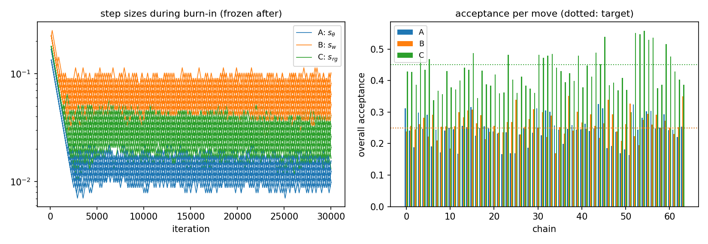

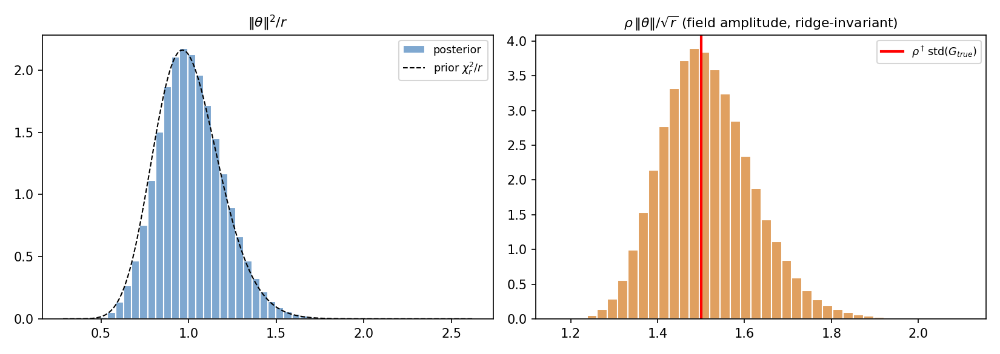

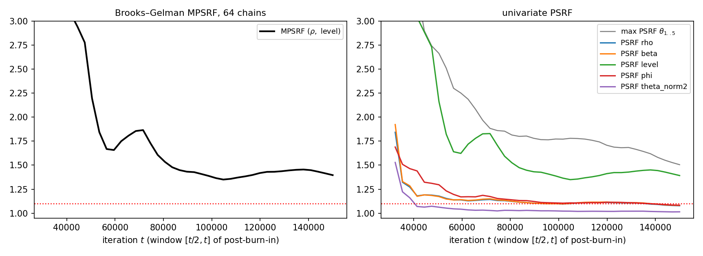

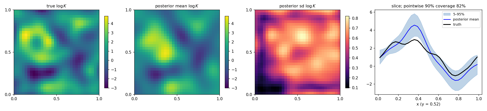

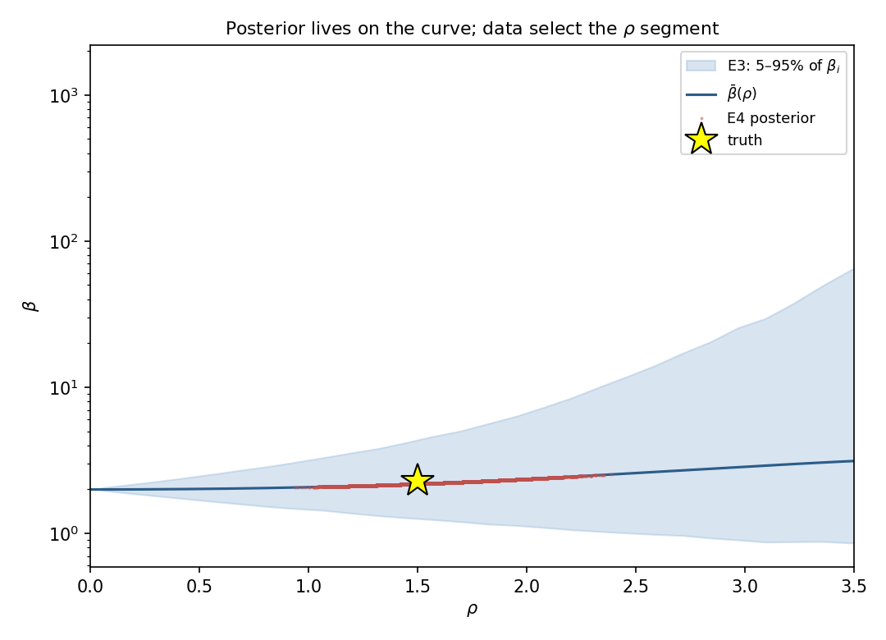

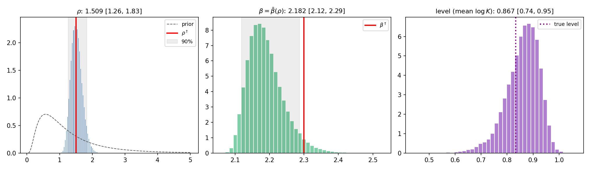

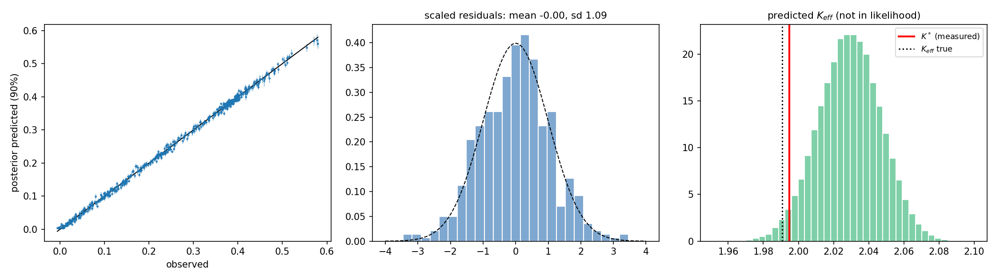

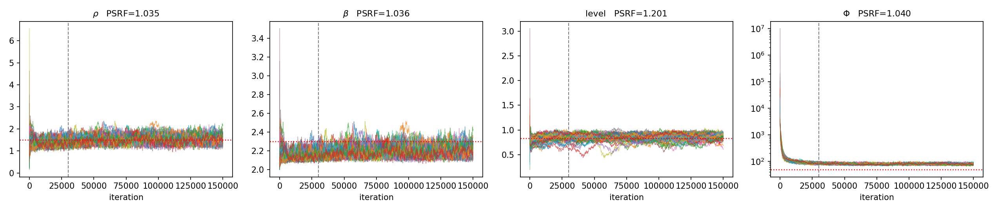

## combined

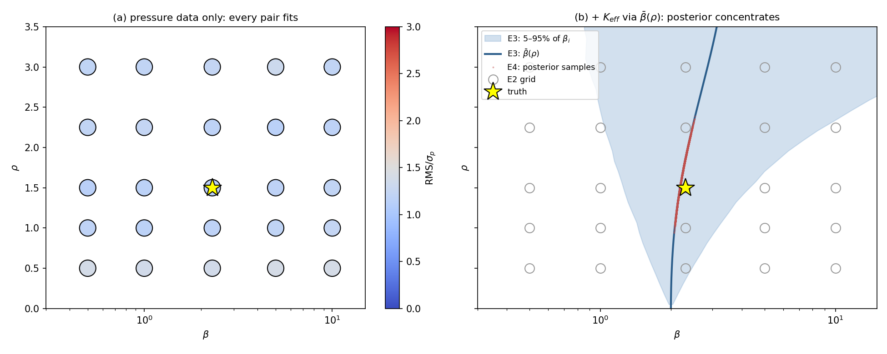
